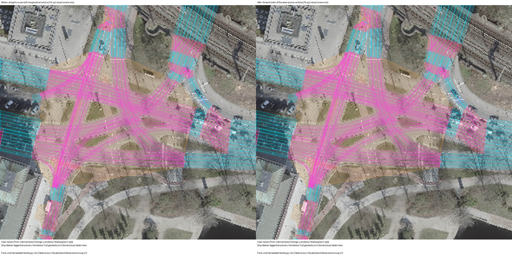
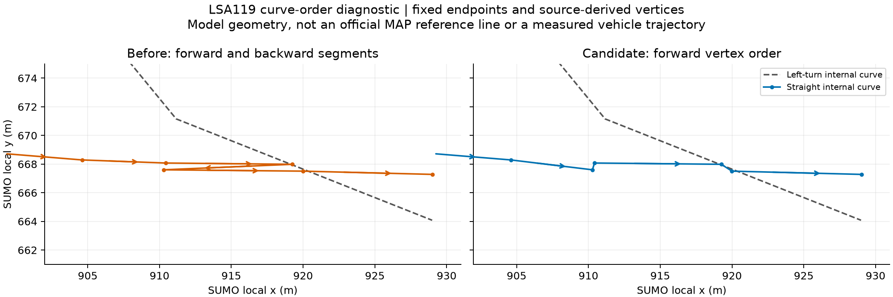

# 汉堡 LSA119 直行内部曲线回折：碰撞复现与候选修复

状态：`review_required`。本包区分已验证的碰撞机制、两车诊断和完整需求复测。精确计数标定尚未完成。

## 已验证的碰撞机制

前次追加 SPSA 的正向评价在 4129.2 秒发生 `junction` 碰撞。
碰撞双方为初始化 OD 时段 78 的 `od_0078_v00053` 和主要窗口 OD 时段 88 的 `od_0088_v00009`。
前者服务于 119 Z12，从 `43866090#0_0` 左转到 `486864294_0`。
后者最终服务于 535 Z4，在 LSA119 从 `199230909#0_3` 直行到 `486864294_1`。

只增加原生 FCD 和换道输出的 4131 秒前缀复现，通过全部七项对应检查。
原生碰撞的每个属性、52 个完整 E1 初始化区间、完成状态、车道保持事件及已完成车辆的出口时刻均一致。
前缀没有完整的主要窗口 15 分钟区间，因此 130 项主要窗口目标在此复现中均未完成，不能填零。
双方在 LSA119 内没有换道。左转车在碰撞时已停止，直行车在移动阶段与其车身相撞。
SUMO 已把两条路径登记为冲突关系，不能按 LSA104 的同源分叉缺失冲突处理。

冻结网络中两条直行曲线各有两处纵向回折。
发生碰撞的直行曲线与左转曲线相交三次，沿直行曲线的交点里程约为 69.894、70.108、89.089 米。
[SUMO 1.27.1 的 MSLink.cpp](https://github.com/eclipse-sumo/sumo/blob/v1_27_1/src/microsim/MSLink.cpp#L325-L390)
对交点排序，并使用最后一个交点计算冲突位置及宽度。
在本例中，回折使首次经过的实体冲突区域与最后交点的里程相隔约 19 米。
配对两车试验支持这类输入几何使原生冲突距离无法及时保护首次经过的区域。
故障类别为 `input-construction-fault`，不据此声称 SUMO 普遍失效。
尚未追溯最早哪个历史导入或拼接步骤产生了这些顶点顺序。

## 一项明确的修复

仅将以下两个明确标注为直行的内部路径顶点按起终点方向前进顺序排列：

- `199230909#0_2 → 486864294_0`
- `199230909#0_3 → 486864294_1`

输入补丁保留全部源顶点，两个端点固定。
SUMO 原生几何清理在两条曲线上各省去一个相邻很近的顶点，均未新增顶点或改变前进顺序，记录见构建清单。
原生重建后，两条曲线相对原曲线的加密采样 Hausdorff 距离约为 0.263 和 0.474 米。
不能用未加密的顶点 Hausdorff 距离证明曲线相同：两条折线的顶点集合相同时，该距离会返回零。
普通道路长度和几何、236 条普通道路清单、全部合法转向和权限、信号绑定及控制程序保持不变。
其他 LSA119 通行曲线的最大偏移为零。此前 LSA104 修复仍然保留。
被修正路径仍有三个很接近的几何交点，其里程跨度降至约 1.373 米；没有把它写成单交点。
内部路径的行驶距离随去除回折而缩短，不是通过任意修改普通道路长度拟合计数。

`materialize_ordered_straights` 只生成显式选择的候选。
它拒绝非直行、其他路口、已有输出目录，以及超出起终点范围或一条车道宽度弦线范围的顶点。
它不会自动排序合法掉头或所有曲线，也不会改变真实观测。

## 两车原生诊断

两次诊断使用相同控制和车辆类型。
初始化时，将左转车放在原记录的停止位置，直行车放在对应内部路径起点。
左转车保持静止至 t=100 秒，随后恢复原生驾驶；两车均禁用自主换道。
这段受控初始化用于隔离几何问题，不是实际需求或计数标定。

| 输入网络 | 碰撞 | 传送 | 最终到达 | 最终等待/在途 |
|---|---:|---:|---:|---:|
| 原曲线 | 1 | 1 | 2 | 0/0 |
| 顶点前进顺序候选 | 0 | 0 | 2 | 0/0 |

原曲线的失败记录完整保留，不能因车辆后来到达就接受该运行。
相关 RED/GREEN 回归和原有 LSA104、轨迹复现及 OD 评价测试已通过。

## 完整需求配对复测

同一组 8603 辆请求从空网运行至 14400 秒，步长 0.1 秒、种子 104。
需求文件、车道意图、控制程序、检测器来源和真实计数均与原正向评价逐字节一致。
只更换网络中的上述两个内部路径。完整复测未增加 LSA119 车道保持或其他驾驶约束。

| 评价 | 字段诊断 MAE | 最大误差 | SSE | 站点诊断 MAE | 碰撞/传送 | 未进入 | 在途 |
|---|---:|---:|---:|---:|---:|---:|---:|---:|
| 原正向评价 | 17.200000 | 62 | 71032 | 53.850 | 1/1 | 1217 | 424 |
| 回折修复后 | 16.730769 | 58 | 71625 | 52.375 | 0/0 | 1381 | 409 |

完整复测支持该需求下的碰撞修复，不证明其他需求均无碰撞。
MAE 和最大误差下降，但 SSE 上升，未进入车辆增加 164 辆。
仍有大量车辆未进入，因此两次评价均不能作为有效标定验收。
`full-native/field-comparison.csv` 保留全部 130 行，计数仅取原生 E1 `nVehContrib`。
`full-native/station-comparison.csv` 保留全部 40 行字段求和结果，不是独立证据。
`results.json` 和原生 XML 保留所有指标，不选择性隐藏变差的项目。

## 航片与诊断图

航片来自冻结的 Hamburg LGV 2026 来源，与此前走廊使用同一文件和哈希。
`astra review render` 保持原走廊展示范围，并增加固定的 LSA119 局部范围。
航片、官方 MAP 参考线及 SUMO 内部曲线是不同证据。
航片年份不能确定拍摄日，也不能证明现场 SPaT。
本候选只修正明显的路径回折，没有据此宣称全部内部路径已符合现场车道标线。





## 复核

在 PowerShell 7 中使用仓库自己的 uv 环境和 SUMO 1.27.1：

```powershell
$env:PYTHONUTF8='1'
$env:PYTHONPATH="$PWD/plugins/astra-sumo/src"
$env:SUMO_HOME="$PWD/.venv/Lib/site-packages/sumo"
$env:PATH="$env:SUMO_HOME/bin;$PWD/.venv/Scripts;$env:PATH"
.venv/Scripts/python.exe -m pytest -q tests/test_junction_straight_geometry.py tests/test_junction_split_fanout.py
.venv/Scripts/python.exe benchmarks/hamburg_ring1_119_straight_order_20261023_v1/reproduce.py --output-dir outputs/lsa119-new-probe
```

`reproduce.py` 从已有冻结源重建候选，运行配对两车诊断，不会覆盖旧结果。
原始记录中的绝对路径属于历史证据，不能照抄为新机器输入。
完整需求验证和计数反馈的结果另列，不能由两车诊断替代。
`local-only-large-traces.json` 列出未加入 Git 的逐秒队列和即时 E1。
完整周期 E1、碰撞、车辆路线、出入记录和运行状态均已冻结，可离线核对全部计数。
选入 Git 的图是同范围走廊对照、LSA119 对照和路径诊断。其余绘图文件留在本机生成目录，绘制报告保留其哈希。
现场 SPaT、Z15 信号组及 LSA200 施工阶段等既有限制仍未解决。
