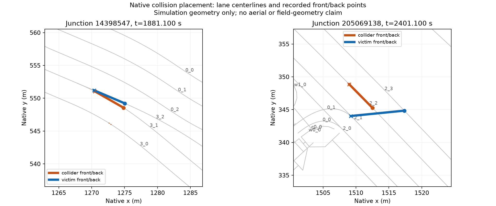

# 汉堡两处碰撞：原生复现与换道位置诊断

本次复现 [通行路线候选](../hamburg_ring1_through_route_coverage_20261021_v1/README.md) 的两处碰撞。
全部 E1 时段记录、碰撞、完成数量和断面保持事件与原运行一致。
独立比较也确认所有车辆的道路离开时刻一致。
新增观测没有改变这些交通结果。两次碰撞和传送仍使运行无效。

## 固定设置与观测

保留全部 8640 辆模型车，其中初始化小时请求 1953 辆，未来主窗 6687 辆。
网络、路线、请求时刻、类型、车道意图、控制程序和原生运行参数均来自父运行快照。
使用仓库 SUMO/TraCI 1.27.1、0.1 秒步长、seed 104，仿真 0–3600 秒。
对应 2026-10-19 04:30–05:30 UTC，即当地 06:30–07:30 CEST。
全部在途车辆静止 300 秒的停止检查保持启用。

只增加四辆涉事车辆的原生 FCD 和全体车辆的原生换道日志。
FCD 给出仿真内位置、车道、速度和角度，换道日志给出实际横向换道及其原生原因。
这些是仿真诊断，不是新增现场观测，也没有反馈到需求或信号控制。
输出方法见 [FCD 文档](https://sumo.dlr.de/docs/Simulation/Output/FCDOutput.html) 和 [换道日志文档](https://sumo.dlr.de/docs/Simulation/Output/Lanechange.html)。
同一时刻的 FCD 可能已包含碰撞后的传送，不能把它当成碰撞瞬间位置。
例如第一辆 collider 在 1881.1 秒的 FCD 已位于出口，碰撞位置须使用原生事件记录。

## 事件一：内部紧急换道

1881.1 秒，车辆从 `:14398547_3_0` 换至 `:14398547_3_1`，原因是 `strategic|urgent`。
两者分别衔接不同入口车道，但位于同一内部边，允许原生横向换道。
另一辆车仍停在同入口分流车道 `:14398547_3_2`，速度约 0.000289 m/s。
碰撞记录的两车车头中心相距 **0.694574 m**。
目标车道折线插值位置与 collider 的原生碰撞位置吻合。
这确认了实际换道和近距离占用，不能只用碰撞类型 `side` 或阶段 `laneChange` 作判断。

该路口 XML 中这些请求的 `foes` 为零，但运行时 `3_1` 与 `3_2` 互为内部冲突车道。
SUMO 会补充同入口分流车道的冲突关系，见 [1.27.1 的 MSLink 初始化](https://raw.githubusercontent.com/eclipse-sumo/sumo/v1_27_1/src/microsim/MSLink.cpp)。
因此，不能将本次碰撞直接解释为缺少冲突位，也不能只补 XML 位图就宣称已修复。

## 事件二：连续换道时车尾仍在右转连接

车辆经 `:205069138_0_1` 右转进入 `189775480_2`。
2395.9 秒，它在位置 0.053967 m 换至车道 3。
2396.0 秒，它在位置 0.326672 m 再换至车道 4，两次原因均为 `strategic|urgent`。

2401.1 秒碰撞时，车头位于车道 4、位置 **4.300945 m**，车辆长度为 5 m。
车尾仍位于右转内部车道 `:205069138_0_1`。
按已行驶位置减车辆长度，沿该内部车道插值，可重构原生车尾坐标，误差小于 $10^{-6}$ m。
此时原生车头与车尾直线相距 **8.167785 m**，表明瞬时换道后的跨车道占用，不能把它画成道路车道 4 内的一辆普通 5 m 直车。
另一辆车沿 `:205069138_2_2` 直行驶出路口，其车身仍与右转连接内的车尾发生原生几何重叠。

运行时两条内部车道互为冲突车道。
本次证据确认了车身跨越路口和两次实际换道，尚未定位到唯一的 SUMO 源码缺陷。
没有证明信号时序错误、道路折线错误或某个连接间隙是唯一原因。



图仅显示仿真车道中心线和原生事件的车头、车尾坐标。它不是航拍核对图，不证明现场几何。
固定范围航拍 before/after 和实际 NetEdit 补充图继续沿用 [最近主窗记录](../hamburg_ring1_z15_k2_full_20261021_v1/README.md)。

## 对标定的影响与下一项

初始化结果仍为 1795 辆进入、1624 辆到达、171 辆在途、158 辆未进入，2 次碰撞、2 次传送。
原生 E1 仍为 1665 次完整通过，全部 52 行可用、33 行一致，诊断 MAE 6.231、最大绝对残差 37。
[全部残差](../hamburg_ring1_through_route_coverage_20261021_v1/analysis/field-change.csv) 保持原样，不能接受这轮计数结果。
主窗没有重跑，原有 130 字段行和 40 派生站点行仍全部保留，零误差目标未完成。

**已验证**：两处碰撞均与内部或刚驶出路口时的实际换道占用有关。
**未验证**：消除这种换道后的全需求安全性、计数影响和真实驾驶合理性。
下一项只提出并检验车身跨越路口期间的换道处理，不改出口比例、信号或车道权限，不删除合法路线。
不能仅禁用碰撞检测、允许传送或降低安全间距来接受结果。
路线先验和原生评价继续采用 [既有论文依据](../../docs/research/ring1-count-fit-basis-2026-10-21-v2.md)，没有增加新的需求优化算法。

## 复现位置

设置项目环境后，在仓库根目录执行：

```powershell
$env:PYTHONPATH = "$PWD/plugins/astra-sumo/src"
$env:SUMO_HOME = "$PWD/.venv/Lib/site-packages/sumo"
$env:PATH = "$env:SUMO_HOME/bin;$PWD/.venv/Scripts;$env:PATH"
$env:PYTHONUTF8 = '1'
.venv/Scripts/python.exe plugins/astra-sumo/scripts/trace_hamburg_collisions.py benchmarks/hamburg_ring1_through_route_coverage_20261021_v1 outputs/new-collision-trace
```

- 执行：[CLI](../../plugins/astra-sumo/scripts/trace_hamburg_collisions.py)、[原生复现与对照](../../plugins/astra-sumo/src/astra_sumo/core/hamburg_collision_trace.py)、[既有逐步执行与车道保持](../../plugins/astra-sumo/src/astra_sumo/core/simulation_stall.py)。
- 输入：[父运行快照](../hamburg_ring1_through_route_coverage_20261021_v1/native/)、[本次声明及输入校验值](native/trace-proposal.json)、[原生命令](native/native-request.json)。
- 原始结果：[完整原生运行](native/)、[观测一致性核对](native/trace-check.json)、[运行时车道冲突](runtime-foes/runtime-foes.json)。
- 分析：[逐车轨迹与换道](analysis/trajectory-context.json)、[位置独立核对](analysis/geometry-check.json)、[事件一采样](analysis/event-0-samples.csv)、[事件二采样](analysis/event-1-samples.csv)。
- 分析脚本：[采样](analyze-through-collision-trace.py)、[运行时冲突](query-through-collision-foes.py)、[位置重构](check-through-collision-geometry.py)、[绘图](plot-through-collision-trace.py)。脚本保留核对时本地路径，冻结数据在同名子目录。
- 验证：[测试](tests.xml)、[实现校验值](implementation-sha256.json)、[文件清单](manifest.json)。

原始大文件以无损 gzip 保存。没有删除父运行或失败证据。
原生状态仍不含断面保持控制器的可验证重启状态，本轮没有从状态重启。
