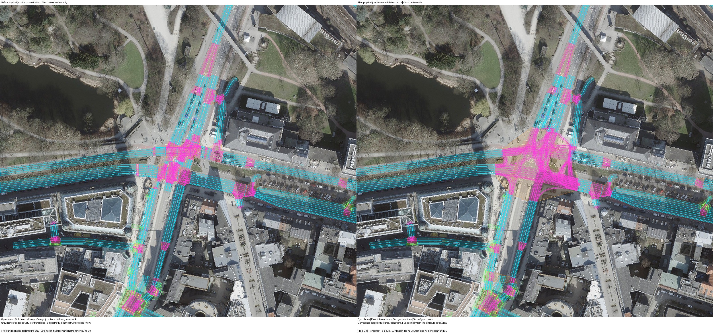
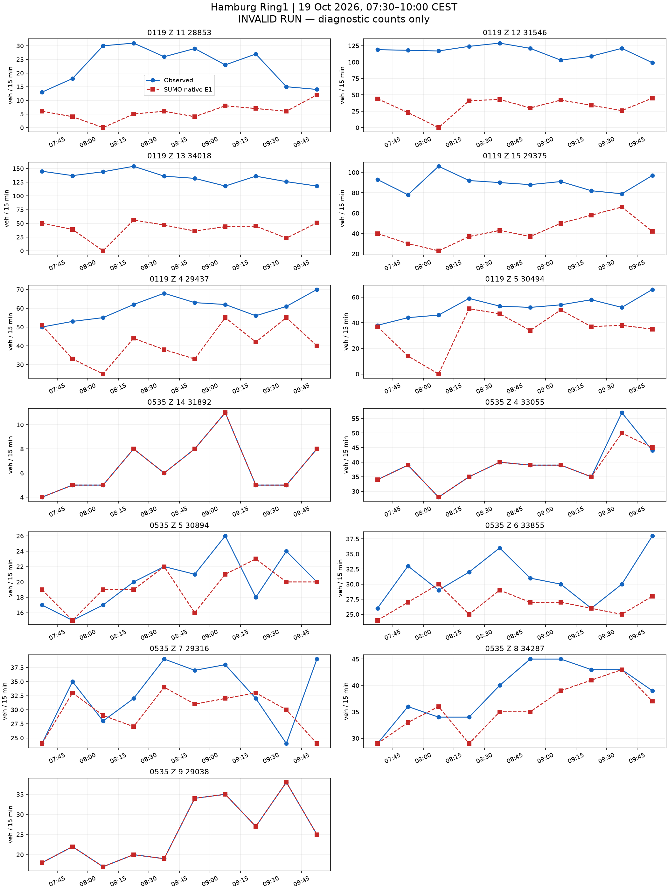
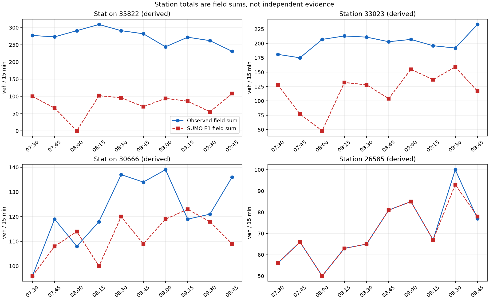
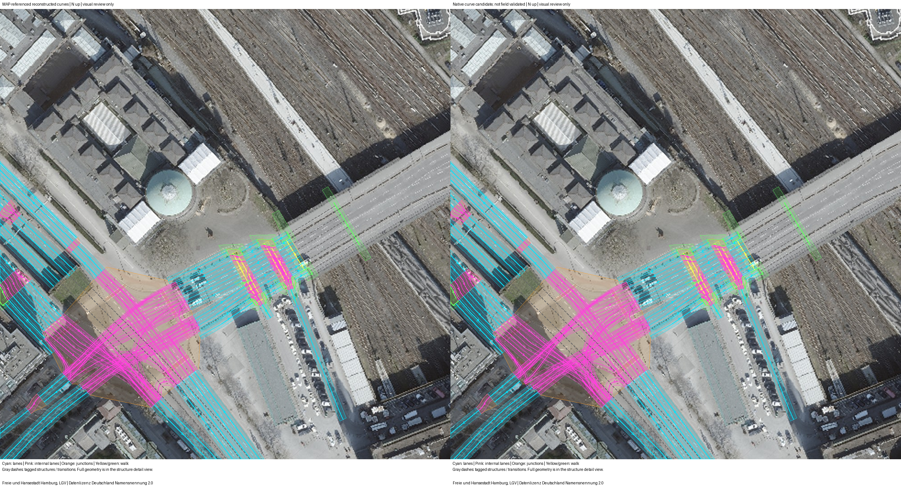

# 汉堡 README 走廊：完整流程与原生计数结果

**未通过标定验收。** 原始 OSM → 道路重要性剪枝 → 物理路口汇聚 → 传感器 → 需求与信号 → 原生仿真 → 同时段计数对比均已有输出。
此处的流程完成不等于标定成功。要求仍为 130 个字段时段和 40 个派生站点时段全部零误差。

范围为 Binnenalster/Ring1，LSA 104、118、119、200、535。固定图像范围为 9.9815,53.5525,10.0065,53.5598。
真实观察窗为 2026-10-19 05:30–08:00 UTC，即 07:30–10:00 CEST。
SUMO 1.27.1，步长 0.1 秒，seed 104，仿真 0 对应当地 06:30，结束 14400 秒。停止检查每 1 秒比较全部在途车辆的速度与位置，静止上限 300 秒。

| 原生运行检查 | 数值 |
|---|---:|
| 计划车辆 | 6687 |
| 实际进入 | 4445 |
| 到达 | 4214 |
| 结束时仍在路网 | 231 |
| 尚未进入 | 2242 |
| 碰撞 | 50 |
| 传送 | 50 |
| 字段可用时段 | 130/130 |
| 字段精确时段 | 35/130 |
| 有效运行的正式计数指标 | 未计算（原生运行无效） |

全部差值见 [130 个字段时段](field-comparison.csv) 和 [40 个派生站点时段](station-comparison.csv)。缺失保留为缺失。
站点值由字段相加，不是独立证据。计数只读原生 E1 的 `nVehContrib`。
诊断 MAE 为 22.684615384615384，诊断最大绝对差为 144；无效运行的这些数值不能作为标定结果接受。

## 走廊与图像





主图由 `astra review render` 生成，前后共用固定范围与同一航拍校验值。航拍为 Hamburg LGV 的 2026 年 WMS 资料，许可为 Datenlizenz Deutschland Namensnennung 2.0，仅作空间背景。
虚拟传感器坐标按当前模型车道长度投影，不是现场测绘验证。


NetEdit 补充图来自真实 NetEdit 1.27.1，使用相同航拍、中心与缩放；after 在 Inspect 模式选中 LSA118。

## 同时段真实计数与 SUMO 计数




## 已声明的模型

需求只使用一次通过路口的路线，每车对应一个被观测字段；没有背景交通、重复道路、绕圈、掉头需求或客户道路通行。网络中的合法转向及掉头保留。
入口沿用真实边界与道路等级上限，完整整数等式在仿真前成立，但不作为仿真成功的证据。
车道意图使用 SUMO 移动途经点，关闭保持右行与速度收益换道；安全换道规则保留。这是声明的驾驶意图，不是已验证的自然驾驶行为。
官方路口采用 M2 的 OCIT 固定方案；Z.15 为带标签的 K9 备选。58 个其余 OSM 信号保留原生感应控制，起始时刻与 seed 固定。它们仍是占位控制，没有现场时序验证。
535 采用已有原生扇出曲线候选，普通道路、显式长度和合法通行权限保持原样。原生曲线不等于官方参考折线或航拍测绘路径。
104、535 两个不符合车道箭头的附加转向声明为红灯；相应道路对仍有其他车道承载。
200 进口施工阶段与 MAP 的不一致、Z.15 官方组未知及其他几何与转向对应限制仍保留。

## 失败记录与结果边界

前三次试跑因入口积压或碰撞被中止，原始输出保留，不能混入有效结果。当前报告覆盖最后一次整时窗运行。
本轮不再继续无上限校正。尚未满足的残差与进入压力直接保留，后续再讨论控制、车道意图和需求可实现性。
入口实际延误及未进入数量见 [逐入口表](entry-delays.csv)。未进入车辆没有被当作零延误。
原生瞬时与周期检测器的对应见 [核对结果](passage-reconciliation.json)，逐车字段记录见 [明细](vehicle-field-passages.csv)。
即使同一窗口精确匹配，也只代表声明模型下的标定拟合，不代表独立预测、真实 OD 或现场信号控制已恢复。

## 复现位置

- 执行：[run_hamburg_readme_pipeline.py](../../plugins/astra-sumo/scripts/run_hamburg_readme_pipeline.py)。
- 需求构造：[hamburg_readme_pipeline.py](../../plugins/astra-sumo/src/astra_sumo/core/hamburg_readme_pipeline.py)。
- 计数与有效性：[detector_demand_replay.py](../../plugins/astra-sumo/src/astra_sumo/core/detector_demand_replay.py)。
- 分析与图像：[hamburg_readme_results.py](../../plugins/astra-sumo/src/astra_sumo/core/hamburg_readme_results.py)。
- 参数与输入：[inputs](inputs/)、原生结果：[native](native/)、各项校验值：[manifest.json](manifest.json)。


复跑冻结输入（输出目录须为新目录）：

```powershell
$env:PYTHONPATH = "$PWD/plugins/astra-sumo/src"
$env:SUMO_HOME = "$PWD/.venv/Lib/site-packages/sumo"
$env:PATH = "$env:SUMO_HOME/bin;$PWD/.venv/Scripts;$env:PATH"
$env:PYTHONUTF8 = '1'
.venv/Scripts/python.exe plugins/astra-sumo/scripts/run_hamburg_readme_pipeline.py run benchmarks/hamburg_ring1_end_to_end_20261021_v1/inputs outputs/ring1-end-to-end-replay
.venv/Scripts/astra.exe review render benchmarks/hamburg_ring1_end_to_end_20261021_v1/review-pruning-request.json outputs/ring1-pruning-review-replay --json
.venv/Scripts/astra.exe review render benchmarks/hamburg_ring1_end_to_end_20261021_v1/review-junctions-request.json outputs/ring1-junction-review-replay --json
```

原始源输入、完整中间路网及实测输出均保留。本包是完整流程试跑证据，不是通过验收的零误差数字孪生。


## 535 几何与来源



左侧为 MAP 参考折线参与的重建，右侧为原生曲线候选；航拍仅作第三方空间背景。曲线候选并未消除本轮全部碰撞。
道路来源为 © OpenStreetMap contributors（ODbL）。保留导入源快照 `source-stages/ring1-full_filtered.osm.xml.gz`；道路等级数量见 [清单](road-class-inventory.csv)。
全部 40 个站点时段均为字段之和。诊断站点 MAE 为 73.175，最大绝对差为 291；这些诊断值不具有有效标定结果的地位。
当前使用单个窗口、单个随机种子，没有独立预测检验。源安全间隔满足并未保证本轮车辆运动有效。
SUMO 的 `stopped` 汇总计数在移动途经点运行中出现负值；本报告未将其用作停车次数或安全证据。碰撞、传送与未进入车辆分别保留原生记录。

绘图环境见 [analysis-runtime.json](analysis-runtime.json)，项目的 `reports` 可选依赖提供 Matplotlib。
本轮只完成流程交付与失败证据收集，没有证明任意需求与控制方案下都无法精确标定。
