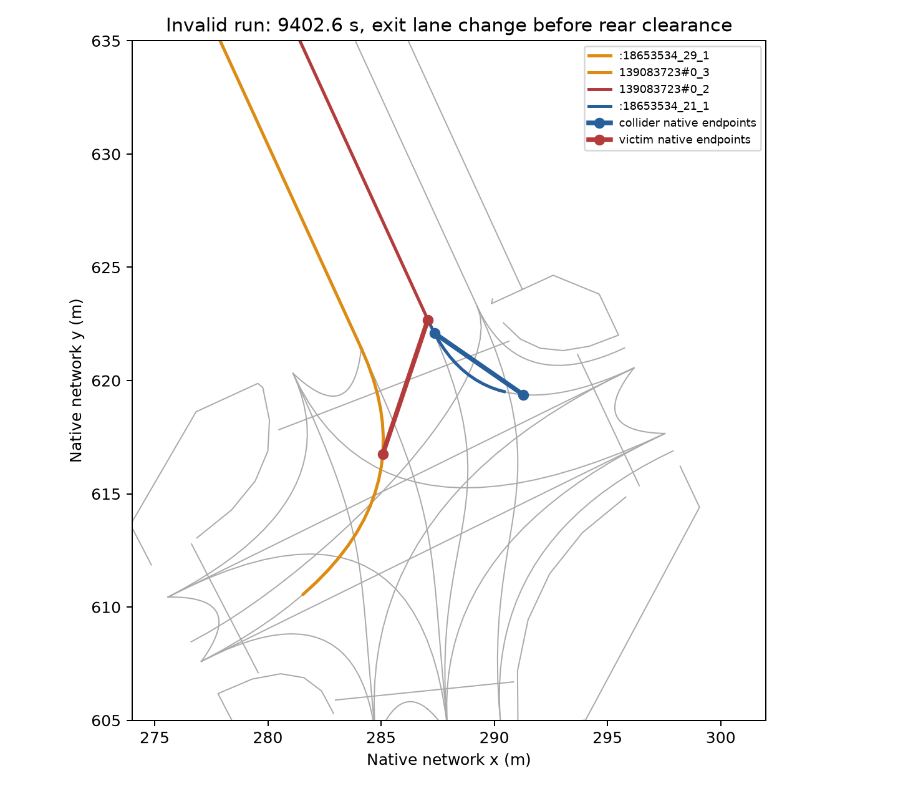

# 汉堡后期碰撞：与完整运行一致的轨迹追踪

本次只追踪 [两个路口局部保持完整运行](../hamburg_ring1_localized_junction_body_full_20261021_v1/README.md) 在 9402.6 秒的碰撞。
原运行仍无效。没有修改需求、道路权限、几何、信号或驾驶控制，也没有宣称消除碰撞。

## 观测一致性

保持原运行的网络、全部 8640 辆车、请求时刻、路线、类型、车道意图、两个保持路口、seed 104、0.1 秒步长和项目 SUMO/TraCI 1.27.1。
从空路网运行至 9420 秒，仅增加两辆涉事车的原生 FCD 和原生换道日志。
未从原生保存状态重启。全部在途车辆静止 300 秒的停止检查保持启用。
运行正常结束，原碰撞和传送均复现。

[逐项核对](native/trace-check.json) 全部通过：碰撞事件的每个属性、已结束周期 E1 的每个属性、完成数、保持事件及全部已到达车辆的道路离开记录一致。
比较路线元素时只忽略元素后的空白；车辆和子元素的属性仍完整比较。
没有为通过核对而重新运行原生仿真。

原始 130 个周期 E1 记录包括 52 个初始化时段和 78 个主窗时段。
真实主窗的 130 行目标全部保留，其中 78 行已结束且可比较；后 52 行尚未结束，不补零。
追踪的局部末段不替代原运行的完整 15 分钟计数。
所有 130 字段及 40 派生站点的完整残差仍见父运行。

## 实际换道与车身位置

9402.6 秒，原生换道日志记录 `readme_f4_b4_p208_v5` 从 `139083723#0_3` 换至 `139083723#0_2`，原因为 `strategic|urgent`。
它在碰撞 XML 中被标为 victim。另一辆 collider 没有相应换道记录，碰撞时速度为零。
因此，不能从 collider 标签或 `side` 类型判断谁执行了换道。

换道时车头在出口位置 0.179411 m，车长 5 m。
车尾仍在 `:18653534_29_1`，尚未驶离转弯连接。
按原生逻辑长度和车道折线独立重构的车尾与碰撞记录相差约 $5.1\times10^{-13}$ m。
车头、车尾的直线距离为 6.265983 m，反映瞬时换道后跨车道占用。
同一时刻 collider 已被移出 FCD，碰撞位置使用原生碰撞事件，而不是传送后的采样。



图只反映仿真车道和原生事件坐标，不是航拍或现场驾驶验证。
此事件与此前另一处出口换道具有相同的已观测车身跨路口特征，但没有定位到唯一 SUMO 源码缺陷。

两辆车下一道路均为 `234423652#1`，由出口车道 1、2 可达。
victim 原出口车道 3 长 38.38 m，存在驶出车身后再换道的空间。
这只是静态长度核对，不证明新保持规则不会排队或阻塞，也不建立全需求安全性。
下一项可单独检验该处车尾驶离路口前的换道处理，其他交通输入保持固定。
未直接扩大全网保持范围，也未重新启用已证明会阻塞 2.10 m 连接的全局候选。

## 复现位置

- 执行：[追踪命令](../../plugins/astra-sumo/scripts/trace_hamburg_collisions.py)、[追踪与原运行比较](../../plugins/astra-sumo/src/astra_sumo/core/hamburg_collision_trace.py)。
- 参数：[输入校验与改动声明](native/trace-proposal.json)、[原生命令](native/native-request.json)、[完整运行输入](../hamburg_ring1_localized_junction_body_full_20261021_v1/inputs/)。
- 原始结果：[原生目录](native/)、[FCD](native/collision-fcd.xml.gz)、[换道](native/lanechanges.xml.gz)、[碰撞](native/collisions.xml)、[一致性检查](native/trace-check.json)。
- 分析：[位置重构](analysis/geometry-check.json)、[逐步采样](analysis/event-samples.csv)、[分析脚本](analyze-late-fanout-collision.py)。
- 检查：[测试](tests.xml)、[实现校验](implementation-sha256.json)、[文件清单](manifest.json)。

设置项目环境后，在仓库根目录执行：

```powershell
$env:PYTHONPATH = "$PWD/plugins/astra-sumo/src"
$env:SUMO_HOME = "$PWD/.venv/Lib/site-packages/sumo"
$env:PATH = "$env:SUMO_HOME/bin;$PWD/.venv/Scripts;$env:PATH"
$env:PYTHONUTF8 = '1'
.venv/Scripts/python.exe plugins/astra-sumo/scripts/trace_hamburg_collisions.py benchmarks/hamburg_ring1_localized_junction_body_full_20261021_v1 outputs/new-late-collision-trace --end 9420
```

分析脚本保留执行时本地目录；冻结原始数据位于同名子目录。大文件采用无损 gzip，保留全部原生记录。
