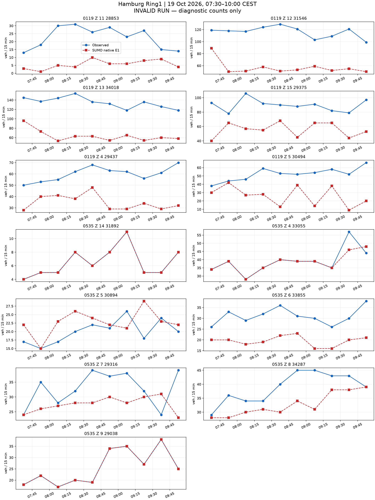
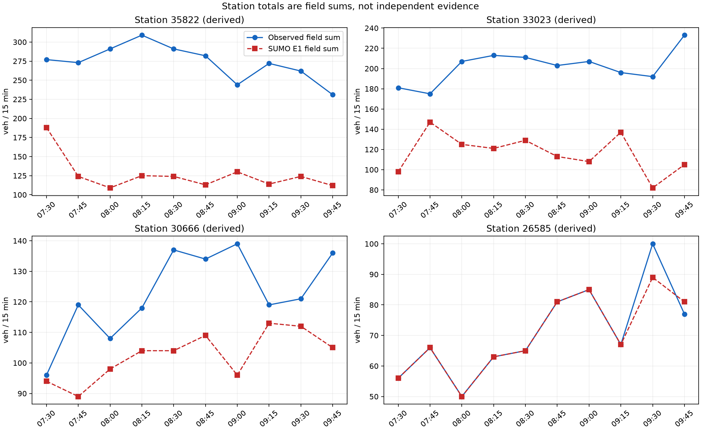

# 汉堡 README 走廊：完整流程与原生计数结果

**未通过标定验收。** 原始 OSM → 道路重要性剪枝 → 物理路口汇聚 → 传感器 → 需求与信号 → 原生仿真 → 同时段计数对比均已有输出。
此处的流程完成不等于标定成功。要求仍为 130 个字段时段和 40 个派生站点时段全部零误差。

范围为 Binnenalster/Ring1，LSA 104、118、119、200、535。固定图像范围为 9.9815,53.5525,10.0065,53.5598。
真实观察窗为 2026-10-19 05:30–08:00 UTC，即 07:30–10:00 CEST。
SUMO 1.27.1，步长 0.1 秒，seed 104，仿真 0 对应当地 06:30，结束 14400 秒。停止检查每 1 秒比较全部在途车辆的速度与位置，静止上限 300 秒。

| 原生运行检查 | 数值 |
|---|---:|
| 计划车辆 | 6687 |
| 实际进入 | 5100 |
| 到达 | 4758 |
| 结束时仍在路网 | 342 |
| 尚未进入 | 1587 |
| 碰撞 | 0 |
| 传送 | 0 |
| 字段可用时段 | 130/130 |
| 字段精确时段 | 31/130 |
| 有效运行的正式计数指标 | 未计算（原生运行无效） |

全部差值见 [130 个字段时段](field-comparison.csv) 和 [40 个派生站点时段](station-comparison.csv)。缺失保留为缺失。
站点值由字段相加，不是独立证据。计数只读原生 E1 的 `nVehContrib`。
诊断 MAE 为 20.153846153846153，诊断最大绝对差为 91；无效运行的这些数值不能作为标定结果接受。

## 走廊与图像


主图由 `astra review render` 生成，前后共用固定范围与同一航拍校验值。航拍为 Hamburg LGV 的 2026 年 WMS 资料，许可为 Datenlizenz Deutschland Namensnennung 2.0，仅作空间背景。
道路数据：© OpenStreetMap contributors，ODbL。官方 MAP、OCIT 及计数资料沿用仓库冻结来源包的署名与许可。
虚拟传感器坐标按当前模型车道长度投影，不是现场测绘验证。


NetEdit 补充图来自真实 NetEdit 1.27.1，使用相同航拍、中心与缩放；after 在 Inspect 模式选中 LSA118。

## 同时段真实计数与 SUMO 计数




## 已声明的模型

需求只使用一次通过路口的路线，每车对应一个被观测字段；没有背景交通、重复道路、绕圈、掉头需求或客户道路通行。网络中的合法转向及掉头保留。
入口沿用真实边界与道路等级上限，完整整数等式在仿真前成立，但不作为仿真成功的证据。
车道意图按输入 `lane-intentions.json` 中记录的机制执行。这是声明的驾驶意图，不是已验证的自然驾驶行为。当前设置见本报告 `results.json` 的 scenario。
官方路口采用 M2 的 OCIT 固定方案；Z.15 为带标签的 K9 备选。58 个其余 OSM 信号保留原生感应控制，起始时刻与 seed 固定。它们仍是占位控制，没有现场时序验证。
535 采用已有原生扇出曲线候选，普通道路、显式长度和合法通行权限保持原样。原生曲线不等于官方参考折线或航拍测绘路径。
104、535 两个不符合车道箭头的附加转向声明为红灯；相应道路对仍有其他车道承载。
200 进口施工阶段与 MAP 的不一致、Z.15 官方组未知及其他几何与转向对应限制仍保留。

## 失败记录与结果边界

此前试跑因入口积压或碰撞失败，原始输出保留，不能混入有效结果。当前报告仅覆盖所声明的本次原生运行。
本轮不再继续无上限校正。尚未满足的残差与进入压力直接保留，后续再讨论控制、车道意图和需求可实现性。
入口实际延误及未进入数量见 [逐入口表](entry-delays.csv)。未进入车辆没有被当作零延误。
原生瞬时与周期检测器的对应见 [核对结果](passage-reconciliation.json)，逐车字段记录见 [明细](vehicle-field-passages.csv)。
即使同一窗口精确匹配，也只代表声明模型下的标定拟合，不代表独立预测、真实 OD 或现场信号控制已恢复。

## 复现位置

- 执行：[run_hamburg_readme_pipeline.py](../../plugins/astra-sumo/scripts/run_hamburg_readme_pipeline.py)。
- 需求构造：[hamburg_readme_pipeline.py](../../plugins/astra-sumo/src/astra_sumo/core/hamburg_readme_pipeline.py)。
- 计数与有效性：[detector_demand_replay.py](../../plugins/astra-sumo/src/astra_sumo/core/detector_demand_replay.py)。
- 分析与图像：[hamburg_readme_results.py](../../plugins/astra-sumo/src/astra_sumo/core/hamburg_readme_results.py)。
- 参数与输入：[inputs](inputs/)、原生结果：[native](native/)、各项校验值：[manifest.json](manifest.json)。

## 本次车道引导变更

本包在上一轮完整流程之后，只调整车道引导。网络、控制、传感器和全部真实计数保持字节一致。
移除未观测路段的全部途经点。每辆车仅在目标检测道路末端前 7.5 米设置一个移动途经点。
短于 7.5 米的单车道检测道路不需要车道引导。其余路段恢复原生保持右行与速度收益换道。
6687 辆车的道路路线、出发时间和入口分配不变，没有新增掉头、绕圈或权限修改。

20 辆 Z8 小试验使用 20 秒出发间隔。20 辆全部进入并到达，原生 Z8 计数为 20，没有碰撞、传送或计划停车。
这是局部车道引导检验，不是原观测窗的零误差标定，也不验证真实驾驶行为。
完整需求与前次运行对比见 [变更对比](change-comparison.json)。

复现本次车道引导及完整运行：

```powershell
.venv/Scripts/python.exe plugins/astra-sumo/scripts/run_hamburg_readme_pipeline.py local-lanes benchmarks/hamburg_ring1_end_to_end_20261021_v1/inputs outputs/new-local-lanes
.venv/Scripts/python.exe plugins/astra-sumo/scripts/run_hamburg_readme_pipeline.py run outputs/new-local-lanes outputs/new-local-lanes-run
```

[七个输入文件的字节复现核对](reproduction-check.json) 通过。[测试记录](tests.xml) 保留 55 项通过结果。
所有原生记录位于 [native](native/)，较大的 XML、JSON 和日志使用无损 gzip。
20 辆试验的需求与目标位于 [z8-cohort-inputs](z8-cohort-inputs/)，其原生记录位于 [z8-cohort](z8-cohort/)。
图片沿用同一网络、固定范围与原航拍，计数曲线按本次完整原生结果重绘。
本包不宣称未观测的信号和施工阶段问题已经解决。

## 对比与剩余阻碍

| 检查项 | 前次完整运行 | 本次局部车道引导 |
|---|---:|---:|
| 碰撞 / 传送 | 50 / 50 | 0 / 0 |
| 进入车辆 | 4445 | 5100 |
| 未进入车辆 | 2242 | 1587 |
| 结束时仍在路网 | 231 | 342 |
| 字段精确时段 | 35 / 130 | 31 / 130 |
| 派生站点精确时段 | 9 / 40 | 8 / 40 |
| 诊断字段 MAE | 22.685 | 20.154 |
| 诊断最大绝对差 | 144 | 91 |
| 标定验收 | 未通过 | 未通过 |

入口 `44532531` 仍有 853 辆未进入，`25866659#1` 有 256 辆未进入。
最大实际出发延误分别为 5779.465 秒和 6600.427 秒。其余入口也有积压，详见完整逐入口表。
因此，既定入口分配和自由流出发计划尚未得到有效运行支持。

原生逐车记录显示，1633 辆在计划时段通过指定字段，3034 辆在其他时段通过指定字段。
143 辆只通过其他字段，1877 辆没有完整字段通过记录。这四类覆盖全部 6687 辆车。
这些分类含观测窗外的原生记录，不等于字段残差。详见 [车道实现诊断](lane-realization-diagnostics.json)。
局部途经点尚不能保证密集车流中的字段分配，也没有解决出发与通过时段之间的延误。

原计划对官方转向支持的筛选作用于规划车道序列。恢复原生换道后，实际车道路径的官方对应仍未独立验证。
候选网络还保留一处内部路径出口约 2.860 米的形状端点间隙，见 [几何限制记录](geometry-limit.json)。
本次没有修改该处几何，也没有证据把该间隙认定为计数残差或旧碰撞的原因。
无碰撞只适用于本次完整需求运行，不代表全网几何、现场信号或自然驾驶行为均已验证。

[独立计数核对](independent-count-checks.json) 确认 130 行全部等于原生 `nVehContrib`，40 行站点值全部等于成员字段之和。
观测窗目标总数为 6687，原生通过总数为 4155。全部残差保留，缺失没有作为零处理。
[需求不变量核对](demand-invariants.json) 确认全部车辆属性与道路路线保持不变。
本次不在这些失败结果上继续整数校正，也不宣称零误差在所有可选模型下不可能。
