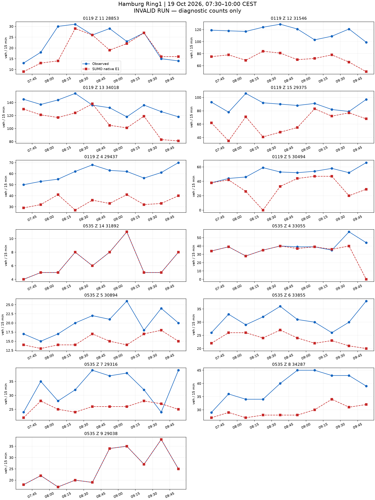
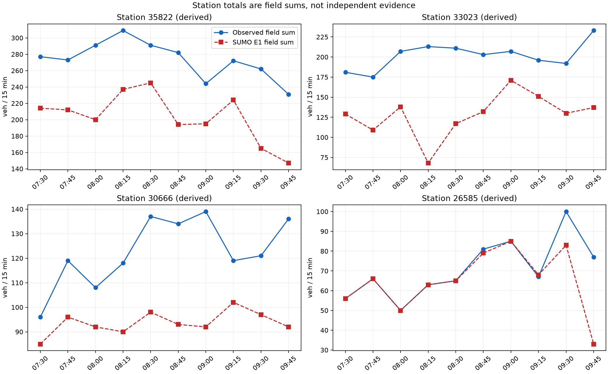

# 汉堡 README 走廊：完整流程与原生计数结果

本次从空路网完成两个路口局部保持候选的 14400 秒运行，未超时，也未从保存状态重启。
保持范围仅为 `14398547`、`205069138`。网络、8640 辆车、路线、请求时刻、真实目标和信号输入与此前 6000 秒候选相同。
前 5400 秒的 78 个已结束 E1 时段与前缀运行逐属性一致，见 [核对](prefix-reproduction-check.json)。

**候选仍无效。** 后期在第三个路口 `18653534` 发生一次碰撞和一次传送。
另有 1367 辆未进入、491 辆在途。完整运行结束不等于车辆需求完成。
[独立追踪](../hamburg_ring1_late_collision_trace_20261021_v1/README.md) 复现了碰撞及此前全部已结束 E1 记录、完成数、保持事件和车辆道路离开时刻。
实际换道发生在车头驶出路口仅 0.179411 m 时，车尾仍在内部转弯连接上。
此证据不证明修正后的全需求安全性，也不能将所有残差归因于该碰撞。

## 原生数据给出的残差分解

6687 辆主窗模型车中，1311 辆在计划时段通过，3301 辆在其他主窗时段通过，391 辆在主窗后通过，1367 辆未进入，317 辆已进入但尚未完成指定字段通过。
初始化车另贡献 288 次主窗通过。原生主窗完整通过共 4900 次。
以上分类逐行重构全部 130 个 `nVehContrib` 残差，见 [逐行分解](data-analysis/row-decomposition.csv) 与 [分解核对](data-analysis/decomposition.json)。
没有缺失字段、额外字段、同字段重复通过或已到达却未通过指定字段的车辆。

未进入的 1367 辆集中于北入口 `44532531`（450）、短支路 `25866659#1`（413）、`448511533#3`（166）及其他入口。
这是当前需求与控制下的运行记录，不能据此推断现场入口容量。
所有车辆，包括未进入和未到达车辆，均保留在 [逐车分解](data-analysis/entry-vehicles.json.gz) 和 [入口表](data-analysis/entry-pressure.csv)。
下一项先验证第三处车身跨越路口时的换道处理；有效性通过后，再分别校正合理入口分配和到达时刻。
本轮未进行整数补车，也未把无效运行的响应当成固定标定模型。

**未通过标定验收。** 原始 OSM → 道路重要性剪枝 → 物理路口汇聚 → 传感器 → 需求与信号 → 原生仿真 → 同时段计数对比均已有输出。
此处的流程完成不等于标定成功。要求仍为 130 个字段时段和 40 个派生站点时段全部零误差。

范围为 Binnenalster/Ring1，LSA 104、118、119、200、535。固定图像范围为 9.9815,53.5525,10.0065,53.5598。
真实观察窗为 2026-10-19 05:30–08:00 UTC，即 07:30–10:00 CEST。
SUMO 1.27.1，步长 0.1 秒，seed 104，仿真 0 对应当地 06:30，计划结束 14400 秒。停止检查每 0.1 秒比较全部在途车辆的速度与位置，静止上限 300 秒。

| 原生运行检查 | 数值 |
|---|---:|
| 计划车辆 | 8640 |
| 实际进入 | 7273 |
| 到达 | 6782 |
| 结束时仍在路网 | 491 |
| 尚未进入 | 1367 |
| 碰撞 | 1 |
| 传送 | 1 |
| 字段可用时段 | 130/130 |
| 字段精确时段 | 29/130 |
| 有效运行的正式计数指标 | 未计算（原生运行无效） |

全部差值见 [130 个字段时段](field-comparison.csv) 和 [40 个派生站点时段](station-comparison.csv)。缺失保留为缺失。
站点值由字段相加，不是独立证据。计数只读原生 E1 的 `nVehContrib`。
诊断 MAE 为 13.884615384615385，诊断最大绝对差为 59；无效运行的这些数值不能作为标定结果接受。

## 走廊与图像

主图由 `astra review render` 生成，前后共用固定范围与同一航拍校验值。航拍为 Hamburg LGV 的 2026 年 WMS 资料，许可为 Datenlizenz Deutschland Namensnennung 2.0，仅作空间背景。
道路数据：© OpenStreetMap contributors，ODbL。官方 MAP、OCIT 及计数资料沿用仓库冻结来源包的署名与许可。
虚拟传感器坐标按当前模型车道长度投影，不是现场测绘验证。

NetEdit 补充图来自真实 NetEdit 1.27.1，使用相同航拍、中心与缩放；after 在 Inspect 模式选中 LSA118。

## 同时段真实计数与 SUMO 计数

## 已声明的模型

需求只使用一次通过路口的路线，每车对应一个被观测字段；没有额外未观测背景车流、重复道路、绕圈、掉头需求或客户道路通行。网络中的合法转向及掉头保留。
本次模型人口包含初始化 1953 辆、主窗 6687 辆。该人口不识别现场独立车辆总量。
入口沿用已声明的道路范围边界和道路等级先验上限。本次按已声明的路线份额和请求时刻构造需求，保留全部目标行。原生 E1 提供拟合结果。
车道意图按输入 `lane-intentions.json` 中记录的机制执行。这是声明的驾驶意图，不是已验证的自然驾驶行为。当前设置见本报告 `results.json` 的 scenario。
官方路口采用 M2 的 OCIT 固定方案；Z.15 为带标签的 K9 备选。58 个其余 OSM 信号保留原生感应控制，起始时刻与 seed 固定。它们仍是占位控制，没有现场时序验证。
535 采用已有原生扇出曲线候选，普通道路、显式长度和合法通行权限保持原样。原生曲线不等于官方参考折线或航拍测绘路径。
104、535 两个不符合车道箭头的附加转向声明为红灯；相应道路对仍有其他车道承载。
200 进口施工阶段与 MAP 的不一致、Z.15 官方组未知及其他几何与转向对应限制仍保留。

## 失败记录与结果边界

此前试跑因入口积压或碰撞失败，原始输出保留，不能混入有效结果。当前报告仅覆盖所声明的本次原生运行。
本轮没有继续需求校正。尚未满足的残差与进入压力全部保留，驾驶处理和需求可实现性仍待验证。
逐入口表保留已写出的进入延误及缺少行程记录的车辆数，见 [逐入口表](entry-delays.csv)。原始行程输出不完整时，缺少记录的车辆状态保持未知。
原生瞬时与周期检测器的对应见 [核对结果](passage-reconciliation.json.gz)，逐车字段记录见 [明细](vehicle-field-passages.csv.gz)。
即使同一窗口精确匹配，也只代表声明模型下的标定拟合，不代表独立预测、真实 OD 或现场信号控制已恢复。

## 复现位置

- 执行：[run_hamburg_readme_pipeline.py](../../plugins/astra-sumo/scripts/run_hamburg_readme_pipeline.py)。
- 需求构造：[hamburg_readme_pipeline.py](../../plugins/astra-sumo/src/astra_sumo/core/hamburg_readme_pipeline.py)。
- 计数与有效性：[detector_demand_replay.py](../../plugins/astra-sumo/src/astra_sumo/core/detector_demand_replay.py)。
- 分析与图像：[hamburg_readme_results.py](../../plugins/astra-sumo/src/astra_sumo/core/hamburg_readme_results.py)。
- 参数与输入：[inputs](inputs/)、原生结果：[native](native/)、各项校验值：[manifest.json](manifest.json)。
