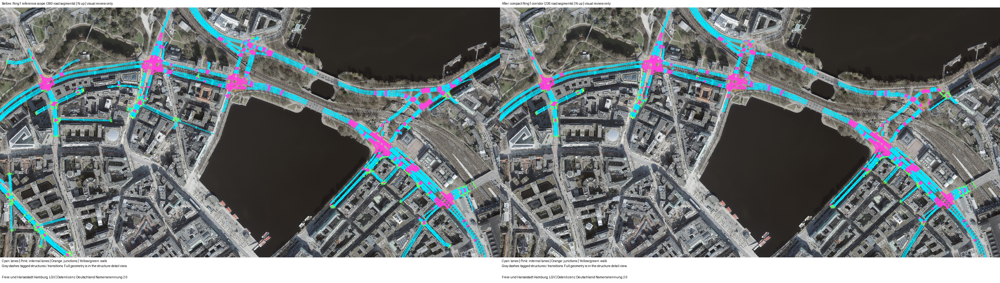
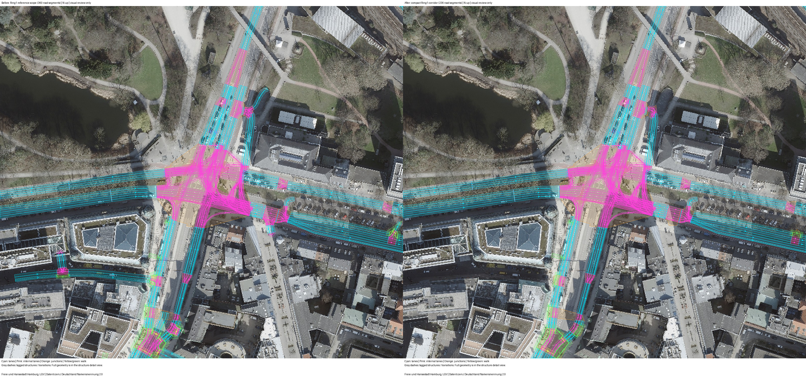

# 汉堡五路口走廊剪枝与重新标定

范围已生成并检查，航拍before/after已先展示。新的完整原生运行已结束，重新标定未通过。
本次仍是README的Binnenalster/Ring1，LSA104、118、119、200、535及原固定bbox。
采用[已核查文献中的走廊和边界处理](../../docs/research/hamburg-pruning-literature-2026-10-22-v1.md)，没有搬用慕尼黑研究筛除检测数据的做法。

## 已验证的范围

| 项目 | 原参考 | 本次候选 |
|---|---:|---:|
| 普通道路段 | 360 | 236 |
| 官方物理路口 | 5 | 5 |
| 官方构建部分及程序 | 9 | 9 |
| 检测字段 | 13 | 13 |
| 主窗字段时段 | 130 | 130 |
| 派生站点时段 | 40 | 40 |

排除124条范围外道路。保留既有单次通过通路、五个路口的全部现有进出口、13个断面及必要反向车行道。
各路口进口向上游、出口向下游延伸到源网络道路边界，优先选择源道路等级较高的可达边界。
这些是模型道路断口，不是已测得的现场OD。完整保留既有路口，不代表此前未确定的官方车道对应已解决。
每条道路的理由见[selection.json](selection.json)，边界见[boundaries.json](boundaries.json)。

保留道路的整个普通道路XML内容恢复为原参考，形状、显式长度、宽度、车道数和权限均不改变。
保留道路间的全部加载车道转向权限逐项相同，没有新增或删除允许的转向。
九个官方程序逐字节相同。其他保留程序仅按原通路和过街道路身份对应信号编号，时长不作优化。
结果有50个控制程序，其中40个非官方OSM程序仍为声明的感应占位程序。
Z.15继续使用带标签的K9备选A。现场SPaT、200施工阶段差异和既有535曲线限制仍未解决。
[范围保持检查](corridor-preservation.json)记录实际源与候选哈希。SUMO 1.27.1完成最终网络加载。

[内部路径对照](internal-path-correspondence.json)另外比较683条保留通路。
五个官方路口内的完整转弯折线没有超过0.000001米的变化；其他路口有20条通路的形状或折线长度变化超过1厘米，其中10条位于需求使用的道路对。
全网最大形状偏差约23米。因此，“普通道路内容完全恢复”不能延伸为“所有内部曲线完全相同”。
本轮碰撞所在的`139083723#0 → 234423652#1`右转通路在源与候选中相同，碰撞原因仍未由这项形状对照确定。

## 固定航拍before/after



左为360条普通路段的已重建参考，右为本次236条走廊。
两幅图使用同一2026年LGV航拍、同一EPSG:25832范围及尺寸，由`astra review render`产生。
航拍SHA-256为`e60229a4341be5415381a9cd36732d3a026fd972c7d7df3969597418d1b3d902`。
源网络为`cc04537494708721e1ad87409ab47cef249c3774dbaf9ed3ec7a7b01710672a4`。
候选为`2d29bdb4183a9491bbd220324742d3a48a3484a96de8adc0eda984ad477cdb7e`。
图的请求与[绘制记录](aerial-review-report.json)保留这些身份。展示产物和最终执行输入的网络字节相同。
2026年航拍不能确定为计数当天拍摄，也不证明MAP施工阶段与现场相同。



NetEdit补充图及记录见[before](netedit-before/)和[after](netedit-after/)。两者均为真实NetEdit 1.27.1。
before复用同一参考哈希的原截图，after重新捕获本候选。
中心不变，按网络初始范围调整百分比zoom，以保持相同的物理宽度。after在Inspect模式选中LSA118。

## 重新准备需求

只使用在原先无碰撞、无传送完整运行中有原生E1完整通过记录的29组路线与车道安排。
按已有道路等级入口上限形成份额先验，在每个字段和时段内重新分配，并限制各入口合计请求数。
同一入口的保留出口路线先均分。该选择是声明的需求先验，不是测得的OD或原生通行能力。
整数种子精确满足输入计数，只用于发起新仿真，不能据此接受标定。

模型仍有8640辆，包括1953辆初始化车和6687辆主窗车。不是现场独立车辆总数的识别结果。
每辆模型车的标识、请求时刻、目标字段和目标时段保持不变。路线份额改变。
观察路段的原有7.5米经过点和车尾清空引导继续使用，三处已声明的路口车身引导保持原样。
这是驾驶意图假设，不是已经验证的自然驾驶行为。

| 入口 | 原参考请求数 | 新种子请求数 |
|---|---:|---:|
| 25866659#1，约8.91米短入口 | 376 | 106 |
| 31106387，服务道路 | 310 | 41 |
| 448511533#3 | 622 | 73 |
| -983227468#1 | 445 | 332 |
| 44532531，主线入口 | 3334 | 3604 |
| 963776077#0，西侧主线入口 | 0 | 1067 |

上述为全体模型车的请求数，尚未证明这些车辆能进入或按目标时段通过。
实际冻结输入位于[inputs](inputs/)，压缩文件解压后保留原字节。
所有130个主窗目标及52个初始化目标原样保留，未删除困难字段，也未填补缺失值。

## 本轮原生标定范围

先运行本候选的新需求种子，再最多运行两次原生计数反馈候选，总计不超过三次。
每次从零时刻连续运行，不依赖尚未验证的状态恢复。
仅使用E1的`nVehContrib`比较全部130行，并报告40个字段和。
首个种子若不安全或未完整测量，不继续拟合。运行保留300秒全体在途车静止停止规则。
反馈只使用本次新运行的通知与计数，不能套用旧参考的排队延误。
接受结果仍须全部计数零误差，且无碰撞、传送或大量未进入。有限尝试未达零不构成不可达证明。

## 完整原生结果：未通过

新种子从零时刻运行至14400秒，全部130个字段时段和40个派生站点时段均可用，没有缺失补零。
原生运行在6782.2秒出现一次LSA104路口内部碰撞及一次传送，所以按原定规则取消后续计数修正。
本轮实际运行一次，没有用整数方程或不安全运行接受标定。全部[字段残差](seed/field-comparison.csv)、[站点残差](seed/station-comparison.csv)和[图文报告](seed/report.html)均保留。

| 项目 | 原360条道路参考 | 本次236条道路种子 |
|---|---:|---:|
| 字段总绝对误差 | 1685 | 1658 |
| 字段诊断MAE | 12.961538 | 12.753846 |
| 字段最大绝对误差 | 59 | 52 |
| 字段完全一致时段 | 31/130 | 22/130 |
| 派生站点诊断MAE | 39.725 | 40.500 |
| 派生站点最大绝对误差 | 150 | 125 |
| 派生站点完全一致时段 | 7/40 | 0/40 |
| 未进入 | 644 | 621 |
| 结束时在途 | 306 | 394 |
| 碰撞 / 传送 | 0 / 0 | 1 / 1 |

两列均不是通过验收的标定结果。新方案同时改变走廊范围和入口份额，这张表不能独立识别剪枝的因果效果。
短入口`25866659#1`的106辆、服务道路`31106387`的41辆和西侧主线`963776077#0`的1067辆均进入。
其他入口仍有积压：`-983227468#1`为188辆、主线`44532531`为185辆、`-142944318`为120辆，其余入口合计128辆未进入。
完整[逐入口表](seed/entry-delays.csv)保留进入延误。未进入加在途合计由950增至1015，不能只引用未进入数量的下降。

仍阻碍验收的声明包括：局部驾驶意图尚未经现场验证、LSA104碰撞未解决、入口道路等级上限不是原生容量、40个OSM感应程序未经现场时序验证，以及Z.15对应和200施工阶段不确定。
每车只承担一个字段的模型人口及初始化交通状态也未识别真实OD。
本轮在这些声明下未达到零误差；一次不安全候选不能证明任何道路范围或计数目标不可实现。
保留[逐车字段记录](seed/vehicle-field-passages.csv.gz)、[原生E1对应](seed/passage-reconciliation.json.gz)、[碰撞文件](native/collisions.xml.gz)和[完整执行记录](execution.json)。
8640条计划路线均无重复道路、重复原生路口或掉头，网络中88组掉头道路对仍保留，见[需求路径检查](demand-path-check.json)。

## 执行与资料

- 范围和需求：[hamburg_corridor_pruning.py](../../plugins/astra-sumo/src/astra_sumo/core/hamburg_corridor_pruning.py)。
- 原生循环：[hamburg_corridor_calibration.py](../../plugins/astra-sumo/src/astra_sumo/core/hamburg_corridor_calibration.py)。
- 执行：[run-calibration.py](run-calibration.py)。用仓库`.venv`，指定新输出目录和固定图像目录。
- 测量：[detector_demand_replay.py](../../plugins/astra-sumo/src/astra_sumo/core/detector_demand_replay.py)。分析：[hamburg_readme_results.py](../../plugins/astra-sumo/src/astra_sumo/core/hamburg_readme_results.py)。
- 当前本地候选：`outputs/ring1-munich-corridor-20261022-v3/`。计数运行目录：`outputs/ring1-munich-corridor-calibration-20261022-v1/`。
- 早期转换候选和未运行的准备文件仍保留在旧版outputs，不作为本次原生结果。

在仓库根目录的PowerShell中执行，输出目录须尚不存在：

```powershell
$env:PYTHONPATH="$PWD/plugins/astra-sumo/src"
$env:SUMO_HOME="$PWD/.venv/Lib/site-packages/sumo"
$env:PATH="$env:SUMO_HOME/bin;$PWD/.venv/Scripts;$env:PATH"
$env:PYTHONUTF8='1'
./.venv/Scripts/python.exe benchmarks/hamburg_ring1_munich_corridor_20261022_v1/run-build.py --output-dir outputs/ring1-corridor-rebuild
./.venv/Scripts/python.exe -u benchmarks/hamburg_ring1_munich_corridor_20261022_v1/run-calibration.py --prepared-dir outputs/ring1-corridor-rebuild/calibration-inputs --figure-dir benchmarks/hamburg_ring1_munich_corridor_20261022_v1/figure-sources --output-dir outputs/ring1-corridor-replay
```

[重新构建](run-build.py)不运行交通，只生成范围、控制和需求，并逐字节检查七份执行输入与本项冻结内容相同。
该检查已通过，见[复现记录](reproduction-check.log)。也可直接把`--prepared-dir`指向本项压缩的`inputs`。
完整固定图像、航拍和NetEdit补充图保存在[figure-sources](figure-sources/)，不依赖旧本地outputs目录。

底图：Freie und Hansestadt Hamburg, LGV，Datenlizenz Deutschland Namensnennung 2.0。
原道路数据：© OpenStreetMap contributors，[ODbL](https://www.openstreetmap.org/copyright)。
