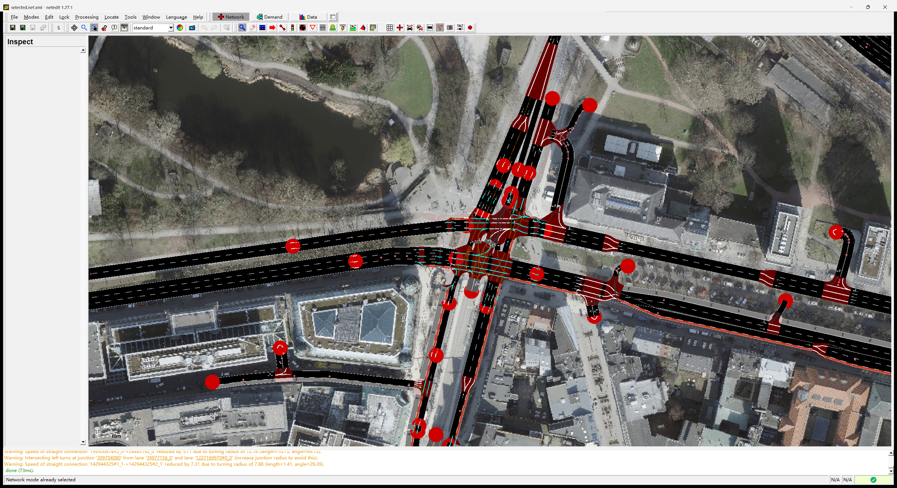
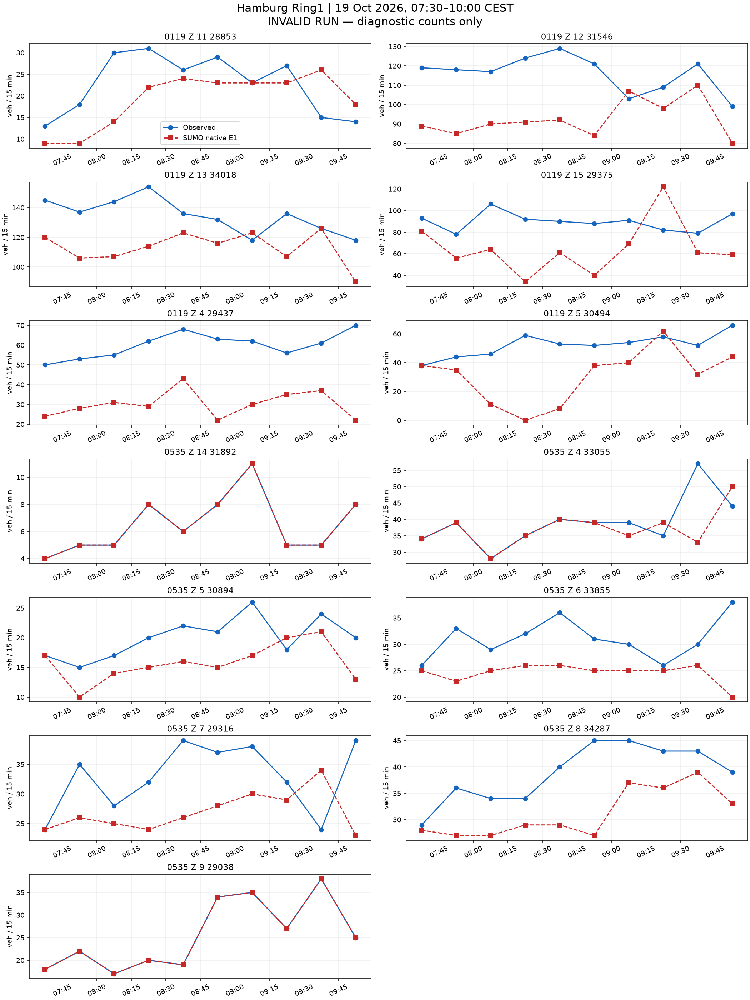
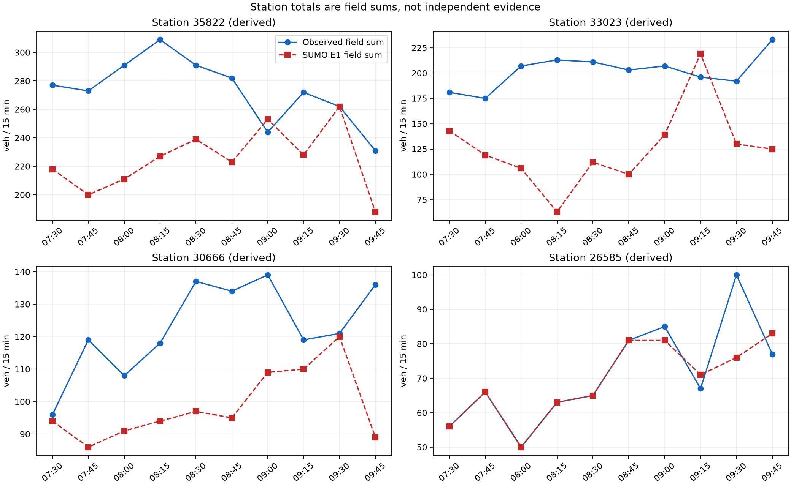

# 汉堡 README 走廊：完整流程与原生计数结果

本次完整检验 [Z.12 入口方案](../hamburg_ring1_primary_entry_prefix_20261022_v1/README.md)。
294 辆车改用已有主干道入口，其中初始化 73 辆、主窗 221 辆。
全部 8640 辆车的 ID、请求时刻、目标字段、出口和汇合后的路线保持原样。
网络、道路权限、信号输入、三处车身保持及原生运行设置均保留。
从空路网运行至 14400 秒，未超时，也未从状态重启。

## 入口改善仍不足以完成标定

本次仍为 0 碰撞、0 传送，原六辆涉事车均驶过对应路口并到达。
前 3600 秒的全部 52 个 E1 时段逐属性复现前缀结果，见 [核对](analysis/prefix-reproduction-check.json)。
整段结果另行测量，没有把前缀改善当成主窗结论。

| 诊断检查 | 原三处保持基线 | 加入入口方案 |
|---|---:|---:|
| 实际进入 | 7656 | 7996 |
| 到达 | 7342 | 7690 |
| 未进入 / 在途 | 984 / 314 | 644 / 306 |
| 碰撞 / 传送 | 0 / 0 | 0 / 0 |
| 一致字段时段 | 32/130 | 31/130 |
| 一致派生站点时段 | 6/40 | 7/40 |
| 字段诊断 MAE | 13.654 | 12.962 |
| 字段最大绝对误差 | 61 | 59 |
| 派生站点诊断 MAE | 43.225 | 39.725 |
| 派生站点最大绝对误差 | 130 | 150 |

**仍未通过标定。** 全部 130 个字段和 40 个派生站点时段均可测，但未达到零误差，未进入与在途车辆仍多。
正式计数指标保持为空。站点由字段相加，不是独立证据。
平均误差改善没有同时改善每个时段。字段一致数下降，站点最大误差增大，均完整保留。
全部差值见 [主窗残差](field-comparison.csv)、[派生站点](station-comparison.csv) 和 [与基线逐行比较](analysis/all-130-baseline-comparisons.csv)。

## 入口响应与残差分解

短支路 `25866659#1` 请求从 670 辆降至 376 辆，未进入从 336 辆降至 52 辆。
主干道 `44532531` 请求增加 294 辆，实际进入增加 292 辆，未进入仅从 144 辆变为 146 辆。
这个 3:1 份额仍是汽车道数先验，未识别真实 OD 或现场入口容量。
其他入口也受交通相互作用影响：`-142944318` 未进入从 111 辆降至 16 辆；`448511533#3` 从 199 辆增至 216 辆。
`-983227468#1` 从 138 辆增至 146 辆，`61578529#1` 从 56 辆增至 68 辆。
全表见 [逐入口记录](data-analysis/entry-pressure.csv)，没有只报告改善的入口。

6687 辆主窗模型车中，1270 辆在计划时段通过，3675 辆在其他主窗时段通过，831 辆在窗后通过，644 辆未进入，267 辆已进入但尚未通过指定字段。
初始化车另贡献 237 次主窗通过。原生主窗共有 5182 次完整字段通过。
全部 130 个残差均能逐行重构，见 [分解](data-analysis/row-decomposition.csv) 与 [核对](data-analysis/decomposition.json)。
跨时段分类是本次运行的记账，不预测改变请求时刻后的结果。
没有额外字段、同字段重复通过或已到达却未通过指定字段的车辆。

本轮未增减车辆、校正请求时刻或改变信号输入。
下一项先读取终态车辆和信号状态，定位剩余入口的阻塞，再决定是否还需调整入口。
不把全部剩余误差都归因于短入口，也不继续无依据地增大主干道份额。

实际执行：[本次运行脚本](run-primary-entry-full-20261022-v1.py)。
报告与比较：[分析脚本](analyze-primary-entry-full-20261022-v1.py)。
输入及执行前模型原文：[inputs](inputs/)。原生结果：[native](native/)。
六辆原涉事车的到达和车尾驶离记录见 [逐车核对](analysis/original-participant-check.json)。
原生保存状态仍不含已验证的车道保持重启状态，不能据此恢复校准运行。

**未通过标定验收。** 原始 OSM → 道路重要性剪枝 → 物理路口汇聚 → 传感器 → 需求与信号 → 原生仿真 → 同时段计数对比均已有输出。
此处的流程完成不等于标定成功。要求仍为 130 个字段时段和 40 个派生站点时段全部零误差。

范围为 Binnenalster/Ring1，LSA 104、118、119、200、535。固定图像范围为 9.9815,53.5525,10.0065,53.5598。
真实观察窗为 2026-10-19 05:30–08:00 UTC，即 07:30–10:00 CEST。
SUMO 1.27.1，步长 0.1 秒，seed 104，仿真 0 对应当地 06:30，计划结束 14400 秒。停止检查每 0.1 秒比较全部在途车辆的速度与位置，静止上限 300 秒。

| 原生运行检查 | 数值 |
|---|---:|
| 计划车辆 | 8640 |
| 实际进入 | 7996 |
| 到达 | 7690 |
| 结束时仍在路网 | 306 |
| 尚未进入 | 644 |
| 碰撞 | 0 |
| 传送 | 0 |
| 字段可用时段 | 130/130 |
| 字段精确时段 | 31/130 |
| 有效运行的正式计数指标 | 未计算（原生运行无效） |

全部差值见 [130 个字段时段](field-comparison.csv) 和 [40 个派生站点时段](station-comparison.csv)。缺失保留为缺失。
站点值由字段相加，不是独立证据。计数只读原生 E1 的 `nVehContrib`。
诊断 MAE 为 12.961538461538462，诊断最大绝对差为 59；无效运行的这些数值不能作为标定结果接受。

## 走廊与图像

主图由 `astra review render` 生成，前后共用固定范围与同一航拍校验值。航拍为 Hamburg LGV 的 2026 年 WMS 资料，许可为 Datenlizenz Deutschland Namensnennung 2.0，仅作空间背景。
道路数据：© OpenStreetMap contributors，ODbL。官方 MAP、OCIT 及计数资料沿用仓库冻结来源包的署名与许可。
虚拟传感器坐标按当前模型车道长度投影，不是现场测绘验证。

NetEdit 补充图来自真实 NetEdit 1.27.1，使用相同航拍、中心与缩放；after 在 Inspect 模式选中 LSA118。

## 同时段真实计数与 SUMO 计数

## 已声明的模型

需求只使用一次通过路口的路线，每车对应一个被观测字段；没有额外未观测背景车流、重复道路、绕圈、掉头需求或客户道路通行。网络中的合法转向及掉头保留。
本次模型人口包含初始化 1953 辆、主窗 6687 辆。该人口不识别现场独立车辆总量。
入口沿用已声明的道路范围边界和道路等级先验上限。本次按已声明的路线份额和请求时刻构造需求，保留全部目标行。原生 E1 提供拟合结果。
车道意图按输入 `lane-intentions.json` 中记录的机制执行。这是声明的驾驶意图，不是已验证的自然驾驶行为。当前设置见本报告 `results.json` 的 scenario。
官方路口采用 M2 的 OCIT 固定方案；Z.15 为带标签的 K9 备选。58 个其余 OSM 信号保留原生感应控制，起始时刻与 seed 固定。它们仍是占位控制，没有现场时序验证。
535 采用已有原生扇出曲线候选，普通道路、显式长度和合法通行权限保持原样。原生曲线不等于官方参考折线或航拍测绘路径。
104、535 两个不符合车道箭头的附加转向声明为红灯；相应道路对仍有其他车道承载。
200 进口施工阶段与 MAP 的不一致、Z.15 官方组未知及其他几何与转向对应限制仍保留。

## 失败记录与结果边界

此前试跑因入口积压或碰撞失败，原始输出保留，不能混入有效结果。当前报告仅覆盖所声明的本次原生运行。
本轮保留全部残差和进入压力。车道意图、未知信号对应和初始交通状态等限制仍须声明。
逐入口表保留已写出的进入延误及缺少行程记录的车辆数，见 [逐入口表](entry-delays.csv)。原始行程输出不完整时，缺少记录的车辆状态保持未知。
原生瞬时与周期检测器的对应见 [核对结果](passage-reconciliation.json.gz)，逐车字段记录见 [明细](vehicle-field-passages.csv.gz)。
即使同一窗口精确匹配，也只代表声明模型下的标定拟合，不代表独立预测、真实 OD 或现场信号控制已恢复。

## 复现位置

- 执行：[run_hamburg_readme_pipeline.py](../../plugins/astra-sumo/scripts/run_hamburg_readme_pipeline.py)。
- 需求构造：[hamburg_readme_pipeline.py](../../plugins/astra-sumo/src/astra_sumo/core/hamburg_readme_pipeline.py)。
- 计数与有效性：[detector_demand_replay.py](../../plugins/astra-sumo/src/astra_sumo/core/detector_demand_replay.py)。
- 分析与图像：[hamburg_readme_results.py](../../plugins/astra-sumo/src/astra_sumo/core/hamburg_readme_results.py)。
- 参数与输入：[inputs](inputs/)、原生结果：[native](native/)、各项校验值：[manifest.json](manifest.json)。
