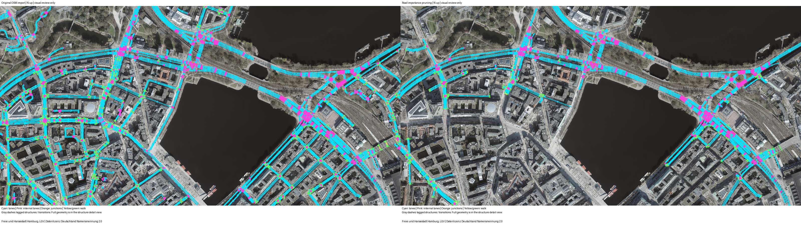
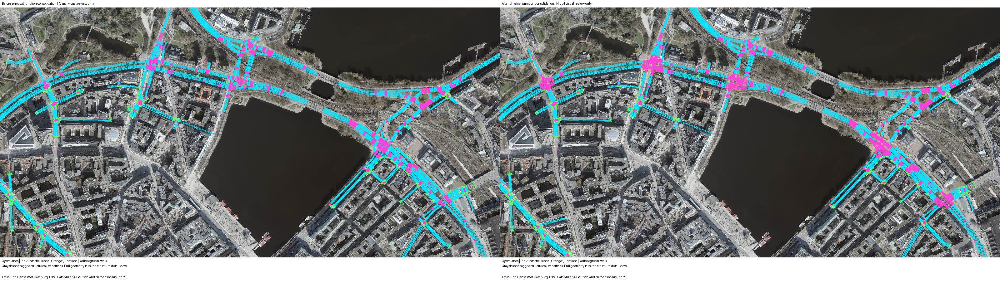
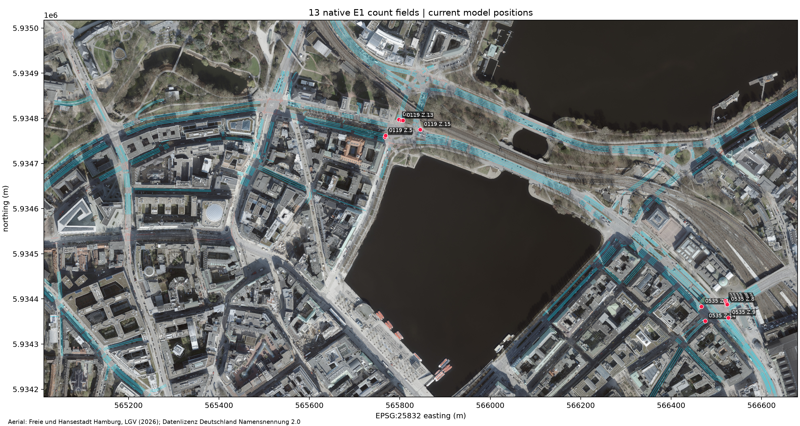
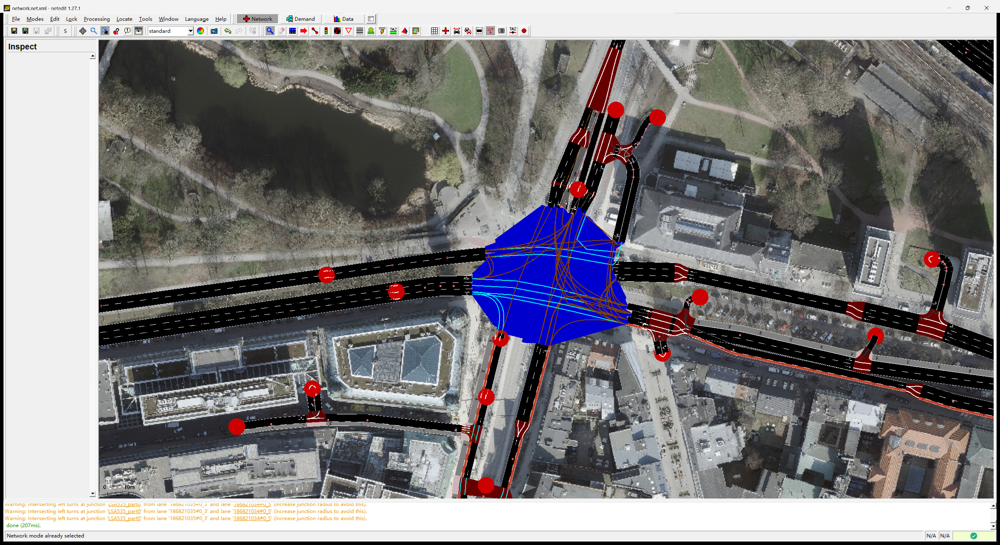
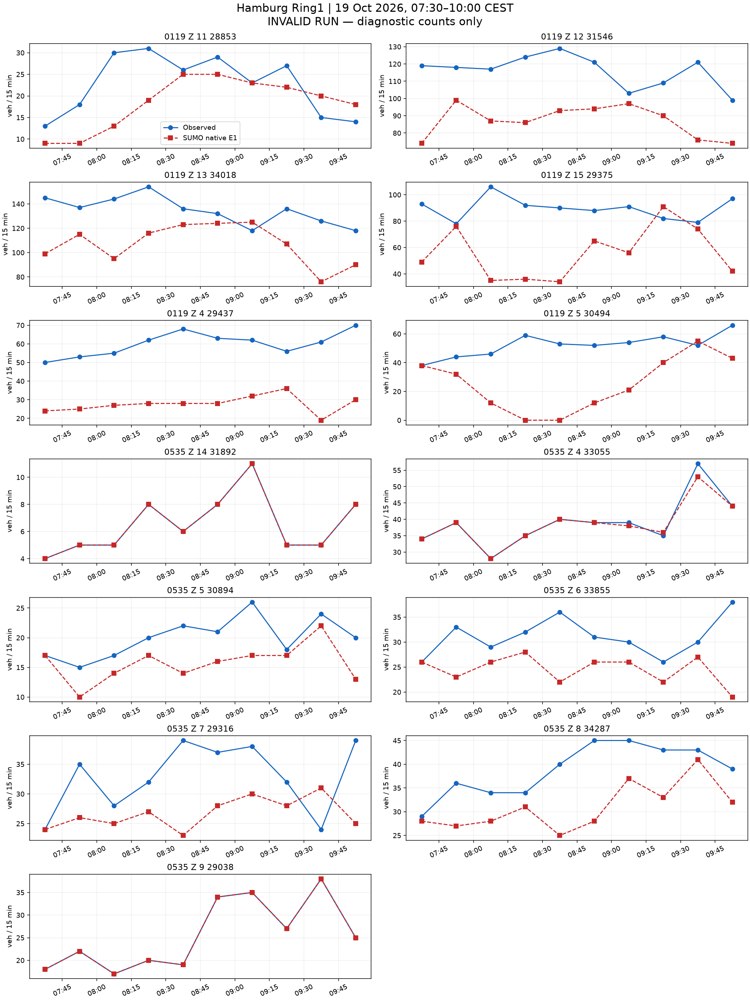
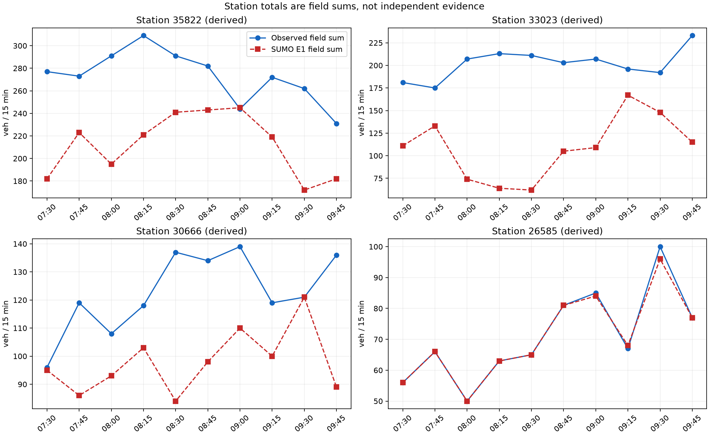

# 汉堡 README 走廊：完整流程与原生计数结果

**本备选未改善完整窗口，不替代原入口候选。** 初始化的小幅改善没有延续到主窗。
当前参考仍为 [原入口候选](../hamburg_ring1_primary_entry_full_20261022_v1/README.md)，其本身也未通过零误差验收。
本次从空路网运行至 14400 秒，未超时、未从状态续跑，网络、信号输入和车辆类型均保留。

## 原生结果与决策

| 检查 | 原入口候选 | 同车多字段备选 |
|---|---:|---:|
| 模型车辆 | 8640 | 8185 |
| 进入 / 到达 | 7996 / 7690 | 7303 / 7011 |
| 未进入 / 在途 | 644 / 306 | 882 / 292 |
| 碰撞 / 传送 | 0 / 0 | 0 / 0 |
| 一致字段时段 | 31/130 | 32/130 |
| 一致派生站点时段 | 7/40 | 8/40 |
| 字段诊断 MAE | 12.962 | 14.331 |
| 字段最大绝对误差 | 59 | 71 |
| 派生站点诊断 MAE | 39.725 | 44.875 |
| 派生站点最大绝对误差 | 150 | 149 |

所有 130 个字段和 40 个派生站点时段均可测，正式计数指标保持为空。
一致数增加没有带来平均误差或进入状况的改善。所有损失均保留，站点仍只是字段之和。
全部差值见 [字段残差](field-comparison.csv)、[派生站点](station-comparison.csv) 和 [与基线逐行比较](analysis/all-130-baseline-comparisons.csv)。

车辆数不同，不能直接把总到达数差当作固定需求下的性能差。
在相同的保留 ID 集合内，基线有 7544 辆进入、7238 辆到达，备选为 7303 辆进入、7011 辆到达。
被配对替代的 455 个合成 ID 中，原基线有 452 辆进入且到达，3 辆未进入。
因此，本次并未通过删除困难的未进入请求来改善指标，保留车辆的进入状况反而变差。

## 结构响应成立，时序配对不足

455 辆共享车全部在两个指定字段各贡献一次，先后次序正确。
没有重复字段、额外字段或到达后缺少声明字段的车辆，见 [逐车签名核对](analysis/native-signature-check.json)。
这支持该路线族可以用现有首次字段意图行驶，不支持这套共享比例或配对时序就是正确 OD。
共享车仍只使用首次字段的保持和原移动经过点，第二字段依路线行驶。其在第二字段的控制暴露与原独立车辆并不相同，容量作用未单独分离。

完整运行的初始化 52 个 E1 时段逐属性复现前缀，见 [前缀核对](analysis/prefix-reproduction-check.json)。
配对账本的 182 行观测配额仍完全守恒，但原生主窗只有 4896 次字段贡献，目标为 6687 次。
原生数据逐行重构了全部 130 个残差。按观测次数计，1240 次在计划时段、3438 次在其他主窗时段、871 次在窗后完成，882 次目标对应车辆未进入，256 次目标对应已进入车辆尚未到达字段。
初始化目标另贡献 218 次主窗观测。
这些单位是字段访问次数，不是独立车辆数。共享车一般可能对应两次缺失目标，不能默认两者相等。
[逐行分解](analysis/all-130-target-visit-decomposition.csv) 和 [总量核对](analysis/target-visit-decomposition.json) 保留这种区分。

新第一字段时刻相对原来源中位晚约 68 秒。
第二字段的时刻代理误差为约 −323 至 +471 秒，中位数约 +33 秒。
455 对中，77 对的第一字段、454 对的第二字段落在各自原目标时段。
这表明只按旧运行的第二道路时刻配对，不能同时修正原有的第一字段时序。
在冻结本次实测通过时刻、保留 90 秒时段边缘余量的条件下，333 对无法用同一个时刻平移同时放入两个目标窗口。
这只是局部时序检查，不是物理不可行证明，也不排除重新配对或改变需求后的结果。
[时序核对](analysis/pair-timing-check.json)、[逐对误差](analysis/pair-timing-errors.csv) 和 [计算脚本](check-shared-population-timing.py) 给出全部数值。

本轮不再提高共享比例或增添车道控制。后续整数与时序校正需要同时处理两个字段的时间窗，并用原生结果验证。
较少模型车辆、精确账本或已实现的双字段签名都不能代替最终标定。

实际执行：[本次运行脚本](run-shared-population-full-20261022-v1.py)。
报告、计数和字段访问分解：[分析脚本](analyze-shared-population-full-20261022-v1.py)。
配置、配对与执行前模型原文：[inputs](inputs/)。全部原生结果：[native](native/)。
原生保存状态仍不能作为已验证的标定续跑状态。

**未通过标定验收。** 原始 OSM → 道路重要性剪枝 → 物理路口汇聚 → 传感器 → 需求与信号 → 原生仿真 → 同时段计数对比均已有输出。
此处的流程完成不等于标定成功。要求仍为 130 个字段时段和 40 个派生站点时段全部零误差。

范围为 Binnenalster/Ring1，LSA 104、118、119、200、535。固定图像范围为 9.9815,53.5525,10.0065,53.5598。
真实观察窗为 2026-10-19 05:30–08:00 UTC，即 07:30–10:00 CEST。
SUMO 1.27.1，步长 0.1 秒，seed 104，仿真 0 对应当地 06:30，计划结束 14400 秒。停止检查每 0.1 秒比较全部在途车辆的速度与位置，静止上限 300 秒。

| 原生运行检查 | 数值 |
|---|---:|
| 计划车辆 | 8185 |
| 实际进入 | 7303 |
| 到达 | 7011 |
| 结束时仍在路网 | 292 |
| 尚未进入 | 882 |
| 碰撞 | 0 |
| 传送 | 0 |
| 字段可用时段 | 130/130 |
| 字段精确时段 | 32/130 |
| 有效运行的正式计数指标 | 未计算（原生运行无效） |

全部差值见 [130 个字段时段](field-comparison.csv) 和 [40 个派生站点时段](station-comparison.csv)。缺失保留为缺失。
站点值由字段相加，不是独立证据。计数只读原生 E1 的 `nVehContrib`。
诊断 MAE 为 14.330769230769231，诊断最大绝对差为 71；无效运行的这些数值不能作为标定结果接受。

## 走廊与图像

主图由 `astra review render` 生成，前后共用固定范围与同一航拍校验值。航拍为 Hamburg LGV 的 2026 年 WMS 资料，许可为 Datenlizenz Deutschland Namensnennung 2.0，仅作空间背景。
道路数据：© OpenStreetMap contributors，ODbL。官方 MAP、OCIT 及计数资料沿用仓库冻结来源包的署名与许可。
虚拟传感器坐标按当前模型车道长度投影，不是现场测绘验证。

NetEdit 补充图来自真实 NetEdit 1.27.1，使用相同航拍、中心与缩放；after 在 Inspect 模式选中 LSA118。

## 同时段真实计数与 SUMO 计数

## 已声明的模型

需求使用简单合法路线，其中 455 辆模型车依次对应两个不同字段，各贡献一次。其余模型车对应一个字段。没有额外背景车流、重复道路、绕圈、掉头需求或客户专用道路通行。网络中的合法转向及掉头保留。
模型车辆共 8185 辆，按首次目标分为初始化 1848 辆和主窗 6337 辆。字段观测配额仍为初始化 1953 次和主窗 6687 次。部分初始化车辆还承担主窗的第二字段目标。模型车辆数不识别现场独立车辆总量或真实 OD。
入口沿用已声明的道路范围边界和道路等级先验上限。本次按已声明的路线份额和请求时刻构造需求，保留全部目标行。原生 E1 提供拟合结果。
车道意图按输入 `lane-intentions.json` 中记录的机制执行。这是声明的驾驶意图，不是已验证的自然驾驶行为。当前设置见本报告 `results.json` 的 scenario。
官方路口采用 M2 的 OCIT 固定方案；Z.15 为带标签的 K9 备选。58 个其余 OSM 信号保留原生感应控制，起始时刻与 seed 固定。它们仍是占位控制，没有现场时序验证。
535 采用已有原生扇出曲线候选，普通道路、显式长度和合法通行权限保持原样。原生曲线不等于官方参考折线或航拍测绘路径。
104、535 两个不符合车道箭头的附加转向声明为红灯；相应道路对仍有其他车道承载。
200 进口施工阶段与 MAP 的不一致、Z.15 官方组未知及其他几何与转向对应限制仍保留。

## 失败记录与结果边界

此前试跑因入口积压或碰撞失败，原始输出保留，不能混入有效结果。当前报告仅覆盖所声明的本次原生运行。
本次备选的全部残差和进入压力保留。未知信号对应、初始库存和模型车辆归属等限制仍须声明。
逐入口表保留已写出的进入延误及缺少行程记录的车辆数，见 [逐入口表](entry-delays.csv)。原始行程输出不完整时，缺少记录的车辆状态保持未知。
原生瞬时与周期检测器的对应见 [核对结果](passage-reconciliation.json.gz)，逐车字段记录见 [明细](vehicle-field-passages.csv.gz)。
即使同一窗口精确匹配，也只代表声明模型下的标定拟合，不代表独立预测、真实 OD 或现场信号控制已恢复。

## 复现位置

- 执行：[run_hamburg_readme_pipeline.py](../../plugins/astra-sumo/scripts/run_hamburg_readme_pipeline.py)。
- 需求构造：[hamburg_readme_pipeline.py](../../plugins/astra-sumo/src/astra_sumo/core/hamburg_readme_pipeline.py)。
- 计数与有效性：[detector_demand_replay.py](../../plugins/astra-sumo/src/astra_sumo/core/detector_demand_replay.py)。
- 分析与图像：[hamburg_readme_results.py](../../plugins/astra-sumo/src/astra_sumo/core/hamburg_readme_results.py)。
- 参数与输入：[inputs](inputs/)、原生结果：[native](native/)、各项校验值：[manifest.json](manifest.json)。
