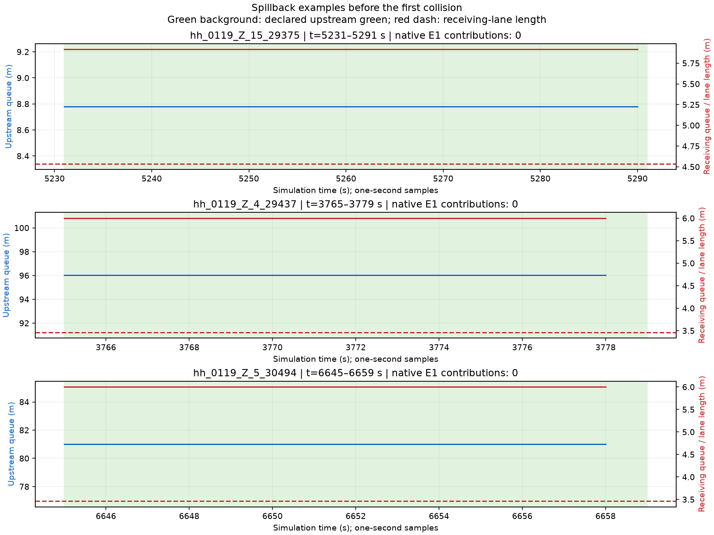

# 汉堡走廊回堵核查

**已在当前236条道路候选中确认回堵证据，集中在119的Z.15、Z.4和Z.5。**
下游接收车道的队尾延伸到路段起点，同时上游有队列且已声明的固定程序为绿灯。
首次碰撞前，三处均出现连续多个采样没有原生E1完整通过贡献的情况。
这支持“下游排队侵占接收空间、妨碍上游放行”，不证明全部残差都由回堵造成。

本项仅复算[236条道路候选](../hamburg_ring1_munich_corridor_20261022_v1/README.md)的完整记录，没有新仿真，没有改变道路、需求、车辆行为或信号。
范围仍为Binnenalster/Ring1五个路口，13个检测字段和130个字段时段均保留，另保留40个派生站点时段。
原运行有一次碰撞和一次传送，仍不具备标定有效性。本项把首次碰撞前的证据单独列出。

## 实际观察

主窗为2026-10-19当地07:30–10:00 CEST，即仿真3600–12600秒。
下表每项都是原生队列输出的1秒采样次数，不是连续观测的精确受阻时长，也不能跨字段相加成为全网时长。

| 字段 | 有上游队列的绿灯采样 | 同时满足下游全接收车道堵满 | 其中首次碰撞前 |
|---|---:|---:|---:|
| 119 Z.11 | 51 | 0 | 0 |
| 119 Z.12 | 354 | 0 | 0 |
| 119 Z.13 | 395 | 0 | 0 |
| 119 Z.15 | 3466 | 3449 | 1267 |
| 119 Z.4 | 1171 | 491 | 189 |
| 119 Z.5 | 685 | 127 | 32 |
| 535 Z.14 | 79 | 0 | 0 |
| 535 Z.4 | 382 | 0 | 0 |
| 535 Z.5 | 522 | 0 | 0 |
| 535 Z.6 | 607 | 0 | 0 |
| 535 Z.7 | 223 | 0 | 0 |
| 535 Z.8 | 34 | 0 | 0 |
| 535 Z.9 | 387 | 0 | 0 |

在有上游队列的绿灯采样中，前三处阳性字段的回堵证据比例分别约为99.5%、41.9%和18.5%。
表中的0只表示没有观察到同时满足本项保守判据的样本。
有些接收车道没有队列报告，另一些存在多条合法接收车道，因此不能据此排除其他位置或其他车道的回堵。
535 Z.9和Z.14仍保持原先全部十个计数时段零误差。普通排队本身不足以说明标定会失败。

## 首次碰撞前的三个例子

| 字段 | 仿真采样区间 | 连续采样数 | 区间内原生E1完整通过贡献 |
|---|---|---:|---:|
| 119 Z.15 | [5231,5291)秒 | 60 | 0 |
| 119 Z.4 | [3765,3779)秒 | 14 | 0 |
| 119 Z.5 | [6645,6659)秒 | 14 | 0 |

首次碰撞为6782.2秒。示例按“首次碰撞前、E1贡献为零的最长连续采样段”选择，是事后机制核查。
Z.4和Z.5的示例覆盖完整14秒名义绿灯。接收道路`79014037#1`对应车道仅长3.46米，报告队长约6米。
Z.15的接收车道`603103445#1_0`长约4.54米，示例报告队长约5.9米。
这些路段都短于本模型5米车身。车辆在接收路段停止时，队尾已侵入上游连接范围。



蓝线为上游队长，红线为接收车道队长，红虚线为接收车道长度。左右纵轴分别标注米数。
绿色背景为已声明的上游固定程序绿灯。图中是1秒采样，不能据折线推定每个0.1秒步长的状态。

## 判据、资料与边界

沿用已核查的[走廊文献和边界排队原则](../../docs/research/hamburg-pruning-literature-2026-10-22-v1.md)。
本项新增的是针对当前运行的队列与放行对应核查，属于探索性机制诊断，不是论文算法复现或容量上界证明。
依据[SUMO队列输出定义](https://sumo.dlr.de/docs/Simulation/Output/QueueOutput.html)，`queueing_length`表示从路口到队尾的距离。
一个阳性样本须同时满足：上游报告正队长、原计划通路处于固定程序绿灯、全部计划乘用车接收车道均报告队长不短于自身长度。
未报告的队列保留未知，不能当成零队长或证明车道空闲。

绿灯由本次安装的固定程序、时差和仿真时刻重建。黄色和熄灭状态不算绿灯。
下游OSM感应信号的实际逐步相位没有保存在这轮记录中，本项没有猜测其红灯时段。
Z.15仍采用原先带标签的K9备选A，官方对应并未由这项核查确定。
队列和信号方案属于模型诊断信息，没有反馈给控制器。计数仍只使用原生E1的`nVehContrib`。
瞬时完整通过事件与周期贡献数已对应，输入身份再次核对。

**还未确定：** 回堵中有多少由重复生成车辆、进车时刻、下游信号、驾驶规则或其他道路拥堵引起。
本项没有把625个三字段净缺口逐项归因于回堵，也没有把一次不安全运行当作容量或不可达证明。
本项只检查检测断面直接接收车道，不排除更远处或断面上游的回堵。
后续应先针对119这条接收道路和信号链核对原因，当前结论不授权删除信号、延长绿灯或放宽车道权限。

## 复算位置

- 执行：[run-analysis.py](run-analysis.py)，只解压已有记录并调用分析，不启动SUMO。
- 分析和图像：[hamburg_spillback.py](../../plugins/astra-sumo/src/astra_sumo/core/hamburg_spillback.py)。
- 原场景、信号和需求：[原候选inputs](../hamburg_ring1_munich_corridor_20261022_v1/inputs/)。
- 完整原生队列：[source-queues.xml.gz](source-queues.xml.gz)。其他原生E1和运行记录沿用[原候选native](../hamburg_ring1_munich_corridor_20261022_v1/native/)。
- [全部13字段](analysis/field-summary.csv)、[全部130时段](analysis/all-130-bin-evidence.csv)、[接收车道](analysis/receiving-lanes.csv)、[全部连续采样段](analysis/episodes.csv)、[逐秒证据](analysis/queue-evidence.csv.gz)。
- 保留原始[130项计数比较](reference-field-comparison.csv)和[40项派生站点比较](reference-station-comparison.csv)，没有修改目标或计数。
- 本地原始运行：`outputs/ring1-munich-corridor-calibration-20261022-v1/`。本次原始分析：`outputs/ring1-munich-spillback-analysis-20261022-v2/`。
- 检查：[tests.log](tests.log)、[复算记录](reproduction.log)、[资料清单](manifest.json)。

在仓库根目录使用原`.venv`，SUMO相关包均为1.27.1，输出目录须为新目录：

```powershell
$env:PYTHONPATH="$PWD/plugins/astra-sumo/src"
$env:PYTHONUTF8='1'
./.venv/Scripts/python.exe benchmarks/hamburg_ring1_spillback_diagnosis_20261022_v1/run-analysis.py --output-dir outputs/ring1-spillback-recheck
```
