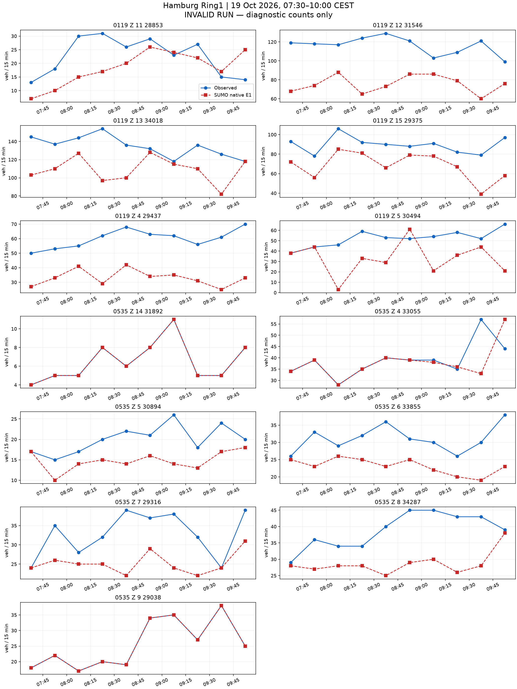
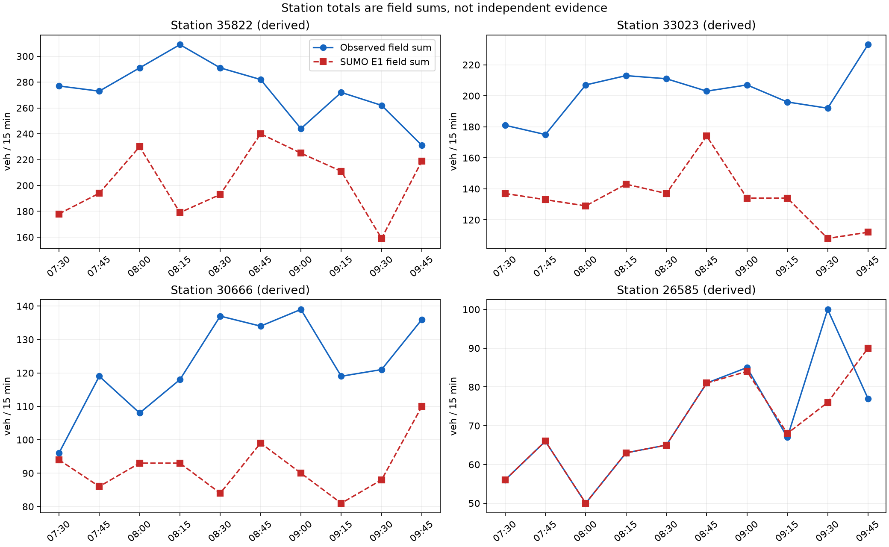

# 汉堡 README 走廊：完整流程与原生计数结果

本次只将车身驶离路口前的保持范围从两处扩至三处：`14398547`、`205069138`、`18653534`。
网络、道路权限、8640 辆车、全部路线、请求时刻、车道意图、真实计数目标和信号输入保持不变。
从空路网完成 14400 秒运行，未超时，也未从状态重启。
此前 [40 辆成对小试验](../hamburg_ring1_late_exit_body_probe_20261022_v1/README.md) 只支持换道机制，本次另检验完整需求。

## 完整运行已验证的变化

原生记录为 0 碰撞、0 传送。原来三处事件的六辆涉事车均已驶过对应路口，车尾驶离出口，并最终到达。
保持期间没有原生换道。第三处出口共记录 412 次车道 3→2 换道，全部在车头位置至少 5 m 后发生。
这些检查包括结束时仍保持的区间，详见 [逐车与保持核对](analysis/driver-and-participant-check.json)。
这是固定 seed 和已声明驾驶、信号假设下的一次完整运行，不证明其他需求或 seed 的安全性，也不证明自然驾驶行为。

| 诊断检查 | 两处保持 | 三处保持 |
|---|---:|---:|
| 碰撞 / 传送 | 1 / 1 | 0 / 0 |
| 进入 / 到达 | 7273 / 6782 | 7656 / 7342 |
| 未进入 / 在途 | 1367 / 491 | 984 / 314 |
| 一致字段时段 | 29/130 | 32/130 |
| 一致派生站点时段 | 6/40 | 6/40 |
| 诊断字段 MAE | 13.885 | 13.654 |
| 诊断最大绝对误差 | 59 | 61 |

**仍未通过标定。** 未进入和在途车辆仍多，最大残差增大。正式计数指标保持为空。
所有 130 个字段时段和 40 个派生站点时段均可测，站点为字段之和，不是独立证据。
派生站点诊断 MAE 为 43.225、最大绝对误差为 130。

## 全部残差的逐车分解

6687 辆主窗模型车中，1229 辆在计划时段通过，3442 辆在其他主窗时段通过，764 辆在窗后通过，984 辆未进入，268 辆已进入但尚未通过指定字段。
初始化车另贡献 315 次主窗通过。原生主窗共记录 4986 次完整字段通过。
这些分类逐行重构全部 130 个残差，见 [逐行分解](data-analysis/row-decomposition.csv) 和 [核对](data-analysis/decomposition.json)。
没有额外字段、同字段重复通过或已到达却未通过指定字段的车辆。

984 辆未进入中，336 辆位于短支路 `25866659#1`，199 辆位于 `448511533#3`，144 辆位于北入口 `44532531`，138 辆位于 `-983227468#1`。
其他入口及全部车辆保留在 [入口表](data-analysis/entry-pressure.csv) 和 [逐车记录](data-analysis/entry-vehicles.json.gz)。
未进入车辆的等待时间只报告下界，不当作零或已观测行程时间。
下一项只处理合理入口分配，先提出小范围可核查方案，再做针对性检验。需求时刻、信号和整数数量本轮未改。

实际执行为 [本次运行脚本](run-three-node-body-full-20261022-v1.py)，分析为 [报告与逐车核对](analyze-three-node-body-full-20261022-v1.py)。
执行前的模型原文及校验值在 [inputs](inputs/)。实际 SUMO 命令在 [本次原生命令](native/native-request.json) 和 [监测记录](native/stall-monitor.json.gz)。
原生状态仅用于诊断，仍不含已验证的车道保持重启状态。

此前后期追踪的外层 `command.json` 摘要曾被事后核对占位覆盖，原摘要未保留。
原生实际命令、输入和输出仍保留，旧文件未重构为原始记录。
现在的只读核对重新确认全部观测一致，详见 [执行记录更正说明](analysis/trace-command-record-note.json)。
报告整理曾遇到压缩文件读取和续算变量两处错误。原生仿真没有重跑，原始错误日志保存在 [分析执行记录](analysis-execution/)。
执行前模型原文保存在 `inputs/implementation-at-execution/`，当前核对实现另见 `implementation/`。

**未通过标定验收。** 原始 OSM → 道路重要性剪枝 → 物理路口汇聚 → 传感器 → 需求与信号 → 原生仿真 → 同时段计数对比均已有输出。
此处的流程完成不等于标定成功。要求仍为 130 个字段时段和 40 个派生站点时段全部零误差。

范围为 Binnenalster/Ring1，LSA 104、118、119、200、535。固定图像范围为 9.9815,53.5525,10.0065,53.5598。
真实观察窗为 2026-10-19 05:30–08:00 UTC，即 07:30–10:00 CEST。
SUMO 1.27.1，步长 0.1 秒，seed 104，仿真 0 对应当地 06:30，计划结束 14400 秒。停止检查每 0.1 秒比较全部在途车辆的速度与位置，静止上限 300 秒。

| 原生运行检查 | 数值 |
|---|---:|
| 计划车辆 | 8640 |
| 实际进入 | 7656 |
| 到达 | 7342 |
| 结束时仍在路网 | 314 |
| 尚未进入 | 984 |
| 碰撞 | 0 |
| 传送 | 0 |
| 字段可用时段 | 130/130 |
| 字段精确时段 | 32/130 |
| 有效运行的正式计数指标 | 未计算（原生运行无效） |

全部差值见 [130 个字段时段](field-comparison.csv) 和 [40 个派生站点时段](station-comparison.csv)。缺失保留为缺失。
站点值由字段相加，不是独立证据。计数只读原生 E1 的 `nVehContrib`。
诊断 MAE 为 13.653846153846153，诊断最大绝对差为 61；无效运行的这些数值不能作为标定结果接受。

## 走廊与图像

主图由 `astra review render` 生成，前后共用固定范围与同一航拍校验值。航拍为 Hamburg LGV 的 2026 年 WMS 资料，许可为 Datenlizenz Deutschland Namensnennung 2.0，仅作空间背景。
道路数据：© OpenStreetMap contributors，ODbL。官方 MAP、OCIT 及计数资料沿用仓库冻结来源包的署名与许可。
虚拟传感器坐标按当前模型车道长度投影，不是现场测绘验证。

NetEdit 补充图来自真实 NetEdit 1.27.1，使用相同航拍、中心与缩放；after 在 Inspect 模式选中 LSA118。

## 同时段真实计数与 SUMO 计数

## 已声明的模型

需求只使用一次通过路口的路线，每车对应一个被观测字段；没有额外未观测背景车流、重复道路、绕圈、掉头需求或客户道路通行。网络中的合法转向及掉头保留。
本次模型人口包含初始化 1953 辆、主窗 6687 辆。该人口不识别现场独立车辆总量。
入口沿用已声明的道路范围边界和道路等级先验上限。本次按已声明的路线份额和请求时刻构造需求，保留全部目标行。原生 E1 提供拟合结果。
车道意图按输入 `lane-intentions.json` 中记录的机制执行。这是声明的驾驶意图，不是已验证的自然驾驶行为。当前设置见本报告 `results.json` 的 scenario。
官方路口采用 M2 的 OCIT 固定方案；Z.15 为带标签的 K9 备选。58 个其余 OSM 信号保留原生感应控制，起始时刻与 seed 固定。它们仍是占位控制，没有现场时序验证。
535 采用已有原生扇出曲线候选，普通道路、显式长度和合法通行权限保持原样。原生曲线不等于官方参考折线或航拍测绘路径。
104、535 两个不符合车道箭头的附加转向声明为红灯；相应道路对仍有其他车道承载。
200 进口施工阶段与 MAP 的不一致、Z.15 官方组未知及其他几何与转向对应限制仍保留。

## 失败记录与结果边界

此前试跑因入口积压或碰撞失败，原始输出保留，不能混入有效结果。当前报告仅覆盖所声明的本次原生运行。
本轮没有继续整数补车。全部残差、进入压力及控制与车道意图限制仍保留。
逐入口表保留已写出的进入延误及缺少行程记录的车辆数，见 [逐入口表](entry-delays.csv)。原始行程输出不完整时，缺少记录的车辆状态保持未知。
原生瞬时与周期检测器的对应见 [核对结果](passage-reconciliation.json.gz)，逐车字段记录见 [明细](vehicle-field-passages.csv.gz)。
即使同一窗口精确匹配，也只代表声明模型下的标定拟合，不代表独立预测、真实 OD 或现场信号控制已恢复。

## 复现位置

- 执行：[run_hamburg_readme_pipeline.py](../../plugins/astra-sumo/scripts/run_hamburg_readme_pipeline.py)。
- 需求构造：[hamburg_readme_pipeline.py](../../plugins/astra-sumo/src/astra_sumo/core/hamburg_readme_pipeline.py)。
- 计数与有效性：[detector_demand_replay.py](../../plugins/astra-sumo/src/astra_sumo/core/detector_demand_replay.py)。
- 分析与图像：[hamburg_readme_results.py](../../plugins/astra-sumo/src/astra_sumo/core/hamburg_readme_results.py)。
- 参数与输入：[inputs](inputs/)、原生结果：[native](native/)、各项校验值：[manifest.json](manifest.json)。
