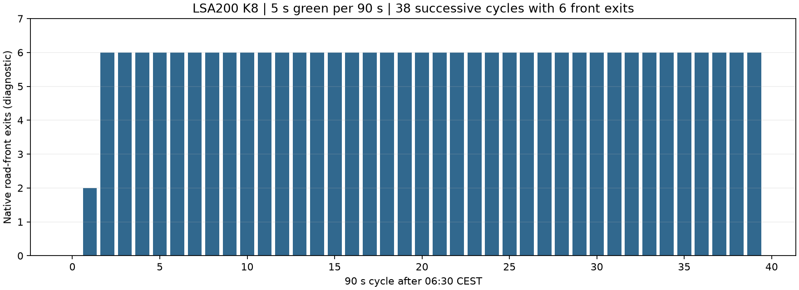

# 汉堡 Z.15 共同路段：K8 的原生受限放行

两种入口路线都将 Z.15 车辆送入 LSA200 的 K8 左转。
当前 SP5 给 K8 每 90 秒 5 秒绿灯。原生第 2–39 个周期各驶出 6 辆。
这为入口替换没有改善提供了具体机制线索，支持先检查路线分配。
它不是现场容量上界，也不支持直接延长绿灯。

本次只读取 [既有入口试验](../hamburg_ring1_ballindamm_entry_probe_20261021_v1/README.md) 的原生文件，没有新运行 SUMO，没有改需求、控制或道路。
原主窗 130 个字段时段和 40 个派生站点时段的标定仍未完成。

## 人口、时段与原生记录

分析范围为 2026-10-19 06:30–07:30 CEST 初始化期中的 Z.15 车辆。
原运行使用 SUMO、TraCI 1.27.1，步长 0.1 秒，seed 104。
本次统一读取 3599.9 秒的原生状态，以及此前完成的行程。
309 辆请求全部保留，没有仅选择已到达车辆。
这些全车行程和位置仅作仿真内诊断，没有输入控制器，也不是新增现场观测。

| 车辆状态 | 数量 |
|---|---:|
| 已到达 | 211 |
| 已进入、仍在路网 | 54 |
| 尚未进入 | 44 |
| 合计 | 309 |

对 265 辆已进入车辆，逐车核对已观测行程时间的分解。
尚未进入的 44 辆保留已等待时间下界，没有赋予零等待。
仍在途车辆的最后一个路段区间保留已耗时间下界，没有推算完成时间。

原生行程文件的普通道路离开时刻采用秒。
状态文件路线设备保存原始整数时间，单位为毫秒，依据 [SUMO 1.27.1 的保存与读取实现](https://raw.githubusercontent.com/eclipse-sumo/sumo/v1_27_1/src/microsim/devices/MSDevice_Vehroutes.cpp) 和 [内部时间定义](https://raw.githubusercontent.com/eclipse-sumo/sumo/v1_27_1/src/utils/common/SUMOTime.h) 解析。
相邻普通道路离开时刻之差包含进入该道路前的内部连接，不能直接当作该普通道路上的停车时间。

## 受限位置与源控制

`186713403#0` 的两个机动车进口车道，经三个物理连接左转到 `142944399#2`。
三条连接均对应源组 K8。它们共享两个进口车道，不能当成三条独立进口车道。
本次按物理道路和车道键读取当前控制连接序号，没有直接沿用旧序号。

源 OCIT 的 200/SP5 与本次安装状态一致：

| 周期内时刻 / 秒 | K8 状态 |
|---|---|
| 0–34 | 红灯 |
| 34–35 | 红黄过渡 |
| 35–40 | 绿灯 |
| 40–43 | 黄灯 |
| 43–90 | 红灯 |

源记录的 34 秒切换包括 1 秒红黄过渡，因此实际绿灯为 5 秒，不能按 6 秒计算。
三个连接的许可绿灯优先关系不同，绿灯时间窗相同。详见 [源组与安装状态](K8-control.json)。
这仍是声明的固定控制，没有由现场信号观测确认当天实际执行情况。
200 的施工阶段不一致、Z.15 下游 K9 备选及其他 OSM 感应控制仍保留。

## 原生放行与时间分布



本小时在 K8 进口记录 230 次道路前端离开。
其周期内时刻均在 35.8–39.7 秒，位于当前绿灯内。
第 0 个周期为 0，第 1 个周期为 2，第 2–39 个周期均为 6。
这些值是原生道路行程诊断，不是 E1 字段计数，也不是实测流量。

| 相关道路区间 | 完整区间数 | 尚未完成区间数 | 完整区间耗时中位数 / 秒 |
|---|---:|---:|---:|
| `551288837#2` 入口 | 248 | 17 | 249.1 |
| `186714394` | 240 | 5 | 65.8 |
| `186714395` | 236 | 4 | 83.4 |
| `186713403#0`，K8 进口 | 230 | 6 | 87.3 |
| `142944399#2`，K8 后 | 230 | 0 | 11.6 |

中位数只针对完整区间。未完成区间的已耗时间另存为下界，不能用完整区间中位数代表全体车辆。
入口高耗时可包含下游排队的回溢，不能据此单独认定入口本身的通行能力。
完整数据见 [道路区间汇总](road-interval-summary.csv)、[逐车区间](vehicle-road-intervals.csv.gz) 和 [逐车状态](population.csv)。

## 与原生 E1 的对应

Z.15 的原生 E1 `nVehContrib` 仍为 222，目标为 309。
309 辆请求可逐车分为：

| 至状态时刻的位置 | 数量 |
|---|---:|
| 已完成 Z.15 字段通过 | 222 |
| 已驶出 K8，但尚未完成字段通过 | 8 |
| 已进入，但尚未驶出 K8 | 35 |
| 尚未进入 | 44 |
| 合计 | 309 |

因此，87 次字段通过的缺口仍保留为 8、35、44 三类。
没有用 230 次道路离开替代 222 次 E1 完整通过。
该人口分解依赖当前一字段一车模型，不识别现场独立车辆总数或真实 OD。
完整初始化 52 行及原主窗 130/40 行的既有残差仍在父证据包中，没有删除。

## 判断、备选与未完成项

**已验证**：当前路线把全部 309 辆 Z.15 初始化模型车辆送经 K8，K8 绿灯与原生周期放行记录一致。
换入口仍经同一受限进口，字段通过数量没有改变。
本次没有通过反事实控制试验排除全部其他影响，不把 6 辆每周期宣称为严格容量上界。

**候选**：现有路线配置 89、252 经其他 LSA200 进口，涉及 K31、K2，避开 K8。
源 SP5 中 K31 为 33 秒绿灯，K2 为 26 秒绿灯。
[结构备选](structural-alternatives.json) 仅保存既有路线和源组对应，没有生成新需求或检验原生实现。
下一项可单独检验该路线分配，保持信号和全部目标不变。
不依据计数缺口直接修改 K8 绿灯，也不把这些备选当作真实 OD。

**未完成**：合理需求分配、全部主窗原生运行有效以及 130 个字段时段和 40 个派生站点时段零误差。
所有计数验收仍只使用原生 E1 `nVehContrib`。

## 复现与证据

在仓库根目录执行，输出目录必须为新目录：

```powershell
$env:PYTHONPATH = "$PWD/plugins/astra-sumo/src"
$env:PYTHONUTF8 = '1'
.venv/Scripts/python.exe plugins/astra-sumo/scripts/diagnose_hamburg_z15_flow.py benchmarks/hamburg_ring1_ballindamm_entry_probe_20261021_v1 outputs/new-z15-diagnosis
```

- 执行：[分析入口](../../plugins/astra-sumo/scripts/diagnose_hamburg_z15_flow.py)。
- 方法与分析：[完整与在途区间](../../plugins/astra-sumo/src/astra_sumo/core/hamburg_route_delay.py)、[独立时间分解检查](analysis-at-verification.py)、[检查结果](independent-checks.json)。
- 场景与原始记录：[父运行](../hamburg_ring1_ballindamm_entry_probe_20261021_v1/)、[源控制资料](../hamburg_ring1_m2_control_20261021_v1/)、[读取参数和来源](report.json)。
- 数值与图：[逐周期数据](K8-exits-by-cycle.csv)、[图像](figures/)、[测试](tests.xml)、[实现校验值](implementation-sha256.json)、[文件清单](manifest.json)。

原网络、需求及计数资料不变，来源许可沿用父证据包。
