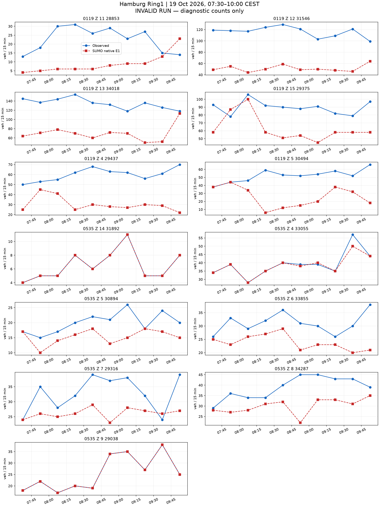
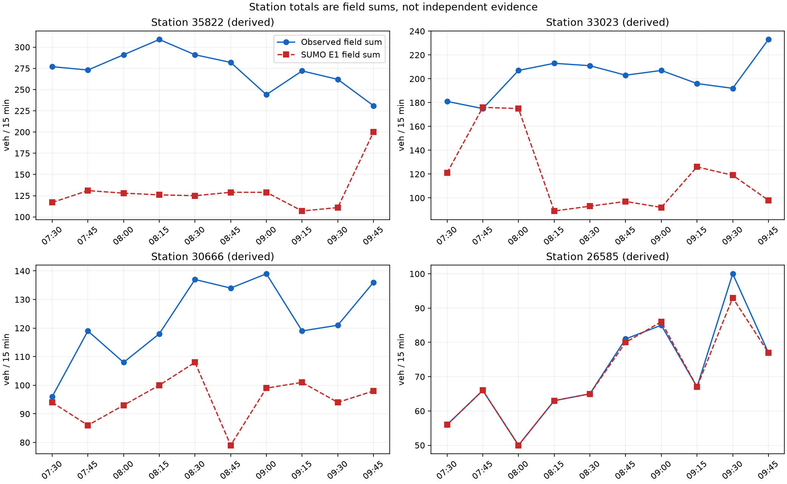

# 汉堡 README 走廊：初始化与 K31/K2 主窗试验（未通过）

本次完整观测窗的 130 行字段计数和 40 行派生站点计数全部可用。
字段只有 32 行一致，站点只有 7 行一致，未达到零误差。
运行触及既有 2400 秒墙钟上限，计划尾段没有完成。原始文件保留，当前没有仍在运行的本次 SUMO 进程。

**未通过标定验收。** 原始 OSM → 道路重要性剪枝 → 物理路口汇聚 → 传感器 → 需求与信号 → 原生仿真 → 同时段计数对比均已有输出。
此处的流程完成不等于标定成功。要求仍为 130 个字段时段和 40 个派生站点时段全部零误差。

范围为 Binnenalster/Ring1，LSA 104、118、119、200、535。固定图像范围为 9.9815,53.5525,10.0065,53.5598。
真实观察窗为 2026-10-19 05:30–08:00 UTC，即 07:30–10:00 CEST。
SUMO 1.27.1，步长 0.1 秒，seed 104，仿真 0 对应当地 06:30，计划结束 14400 秒。停止检查每 0.1 秒比较全部在途车辆的速度与位置，静止上限 300 秒。
原生执行未完成，执行状态为 timeout。下表车辆数量来自 13645.000 秒的最后完整快照，均非计划结束时的最终数量。

| 原生运行检查 | 数值 |
|---|---:|
| 计划车辆 | 8640 |
| 实际进入 | 6267 |
| 到达 | 5877 |
| 快照时仍在路网 | 390 |
| 尚未进入 | 2373 |
| 碰撞 | 0 |
| 传送 | 0 |
| 字段可用时段 | 130/130 |
| 字段精确时段 | 32/130 |
| 有效运行的正式计数指标 | 未计算（原生运行无效） |

全部差值见 [130 个字段时段](field-comparison.csv) 和 [40 个派生站点时段](station-comparison.csv)。缺失保留为缺失。
站点值由字段相加，不是独立证据。计数只读原生 E1 的 `nVehContrib`。
诊断 MAE 为 19.884615384615383，诊断最大绝对差为 86；无效运行的这些数值不能作为标定结果接受。

## 走廊与图像


主图由 `astra review render` 生成，前后共用固定范围与同一航拍校验值。航拍为 Hamburg LGV 的 2026 年 WMS 资料，许可为 Datenlizenz Deutschland Namensnennung 2.0，仅作空间背景。
道路数据：© OpenStreetMap contributors，ODbL。官方 MAP、OCIT 及计数资料沿用仓库冻结来源包的署名与许可。
虚拟传感器坐标按当前模型车道长度投影，不是现场测绘验证。


NetEdit 补充图来自真实 NetEdit 1.27.1，使用相同航拍、中心与缩放；after 在 Inspect 模式选中 LSA118。

## 同时段真实计数与 SUMO 计数




## 已声明的模型

需求只使用一次通过路口的路线，每车对应一个被观测字段；没有额外未观测背景车流、重复道路、绕圈、掉头需求或客户道路通行。网络中的合法转向及掉头保留。
本次模型人口包含初始化 1953 辆、主窗 6687 辆。该人口不识别现场独立车辆总量。
入口沿用已声明的道路范围边界和道路等级先验上限。本次按已声明的路线份额和请求时刻构造需求，保留全部目标行。原生 E1 提供拟合结果。
车道意图按输入 `lane-intentions.json` 中记录的机制执行。这是声明的驾驶意图，不是已验证的自然驾驶行为。当前设置见本报告 `results.json` 的 scenario。
官方路口采用 M2 的 OCIT 固定方案；Z.15 为带标签的 K9 备选。58 个其余 OSM 信号保留原生感应控制，起始时刻与 seed 固定。它们仍是占位控制，没有现场时序验证。
535 采用已有原生扇出曲线候选，普通道路、显式长度和合法通行权限保持原样。原生曲线不等于官方参考折线或航拍测绘路径。
104、535 两个不符合车道箭头的附加转向声明为红灯；相应道路对仍有其他车道承载。
200 进口施工阶段与 MAP 的不一致、Z.15 官方组未知及其他几何与转向对应限制仍保留。

## 失败记录与结果边界

此前试跑因入口积压或碰撞失败，原始输出保留，不能混入有效结果。当前报告仅覆盖所声明的本次原生运行。
本轮不再继续无上限校正。尚未满足的残差与进入压力直接保留，后续再讨论控制、车道意图和需求可实现性。
逐入口表保留已写出的进入延误及缺少行程记录的车辆数，见 [逐入口表](entry-delays.csv)。原始行程输出不完整时，缺少记录的车辆状态保持未知。
原生瞬时与周期检测器的对应见 [核对结果](passage-reconciliation.json)，逐车字段记录见 [明细](vehicle-field-passages.csv.gz)。
即使同一窗口精确匹配，也只代表声明模型下的标定拟合，不代表独立预测、真实 OD 或现场信号控制已恢复。

## 复现位置

- 执行：[run_hamburg_readme_pipeline.py](../../plugins/astra-sumo/scripts/run_hamburg_readme_pipeline.py)。
- 需求构造：[hamburg_readme_pipeline.py](../../plugins/astra-sumo/src/astra_sumo/core/hamburg_readme_pipeline.py)。
- 计数与有效性：[detector_demand_replay.py](../../plugins/astra-sumo/src/astra_sumo/core/detector_demand_replay.py)。
- 分析与图像：[hamburg_readme_results.py](../../plugins/astra-sumo/src/astra_sumo/core/hamburg_readme_results.py)。

## 本次修改与执行边界

本次接续 [人工路线检验及初始化小时](../hamburg_ring1_z15_k2_routes_20261021_v1/README.md)。
模型人口为 1953 辆初始化车加 6687 辆主窗车。Z.15 改用现有 K31/K2 路线，其他主窗车辆的道路路线和全部请求时间保持原样。
原有网络、控制输入、全部 130 行目标及站点字段组成均不变。
原始 OSM、重要性剪枝、物理路口汇聚、传感器、固定航拍图和实际 NetEdit 补充图沿用相同网络证据。
五张沿用的 before/after 与 NetEdit 图逐字节相同，见 [变更比较](change-comparison.json)。

计划从当地 06:30 运行到 10:30，主观测窗仍为 07:30–10:00。
最后完整快照为仿真 13645 秒，即当地 10:17:25。它超过观测窗终点 12600 秒，但没有到达计划终点 14400 秒。
快照记录 6267 辆进入、5877 辆到达、390 辆在途、2373 辆尚未进入，碰撞和传送字段均为 0。
这些是最后完整快照的数量，不是计划终点的最终数量。
执行中断还造成部分 XML 没有闭合、控制过程记录未完成，不能据此证明整个计划运行有效。

原生周期 E1 中保留了 188 条完整记录，全部 130 个目标字段时段均在其中。
恢复过程只读取完整记录，不改写原文件，没有将缺失值当作零。
全部 130 个 `nVehContrib` 已逐项重新核对，40 个站点值已重新按字段相加。
诊断字段 MAE 为 19.884615384615383，最大绝对残差为 86。
派生站点诊断 MAE 为 63.675，最大绝对残差为 183。站点不是独立证据。
正式计数指标保持空值，原生有效运行及精确标定均未成立。

该观测窗中的计数已经写出，补完末尾不能改写这些已记录残差。
本轮不重复同一候选。逐车完整通过身份和车道保持过程的最终记录未恢复，保持未验证。
缺少行程记录的车辆不能逐车认定为未进入，逐入口表将其状态标为未知。
原控制状态文件仍含 `running`，属于中断前写出的状态。执行结果为 `timeout`，本次原生进程已确认结束，见 [执行结论](execution-outcome.json)。

## 与此前结果的关系

此前 [完整车道保持运行](../hamburg_ring1_lane_section_hold_full_20261021_v1/README.md) 的诊断字段 MAE 为 19.154，精确字段时段为 29/130。
本次字段精确行增至 32，最大残差由 96 降至 86，但 MAE 增至 19.885。两次均未通过标定。
此前完整运行没有注入初始化人口，本次同时增加了初始化需求并改变了 Z.15 路线。
因此，这不是单一改动的完整主窗因果比较，不能把差异全部归于 Z.15 路线。
初始化小时的配对比较显示局部改善，完整主窗没有取得可接受的标定结果。

## 阻碍与未验证项

当前一字段一车人口、路线份额、入口先验和原请求时刻仍是模型声明，不是真实 OD。
大量进入等待与跨时段通过仍存在，固定自由流猜测没有完成拥堵下的需求校正。
局部车道保持的自然驾驶依据未验证，58 个 OSM 感应控制仍缺少现场时序，Z.15 官方组和 200 施工阶段差异仍保留。
已有 535 原生曲线候选与其他路径对应限制没有在本次修复。
这些是必须保留的模型限制，不等于每项限制都已被证明是某一残差的原因。
本次失败不能证明所有其他需求方案不可行，也不能降低 MAE=0、最大绝对误差=0 的验收条件。

复现本次固定候选运行：

```powershell
$env:PYTHONPATH = "$PWD/plugins/astra-sumo/src"
$env:SUMO_HOME = "$PWD/.venv/Lib/site-packages/sumo"
$env:PATH = "$env:SUMO_HOME/bin;$PWD/.venv/Scripts;$env:PATH"
$env:PYTHONUTF8 = '1'
.venv/Scripts/python.exe plugins/astra-sumo/scripts/run_hamburg_readme_pipeline.py run benchmarks/hamburg_ring1_z15_k2_routes_20261021_v1/inputs outputs/new-k2-full --hold-observed-lanes
```

该入口沿用 2400 秒执行上限。本包记录的是本次超时失败，不保证其他机器复现相同中断时刻。
较长执行预算可以用于检验尾段，但不会改变相同输入下已写出的主观测窗计数。

- 原始输入：[inputs](inputs/)、[场景声明](inputs/scenario.json)。
- 原始结果：[native](native/)、[严格字段恢复](native/partial-measurements/report.json)、[40 个站点](station-comparison.csv)。
- 分析：[逐项核对](independent-checks.json)、[核对时记录](analysis-at-verification.py)、[逐字段残差](field-residual-summary.json)。
- 执行与比较：[执行状态](execution-outcome.json)、[差异与图像来源](change-comparison.json)、[实时观察记录](live-observation-notes/)。
- 检查：[测试](tests.xml)、[实现校验值](implementation-sha256.json)、[文件清单](manifest.json)。

较大 XML、CSV 和 JSON 使用无损 gzip，原有截断状态保留。
- 参数与输入：[inputs](inputs/)、原生结果：[native](native/)、各项校验值：[manifest.json](manifest.json)。
