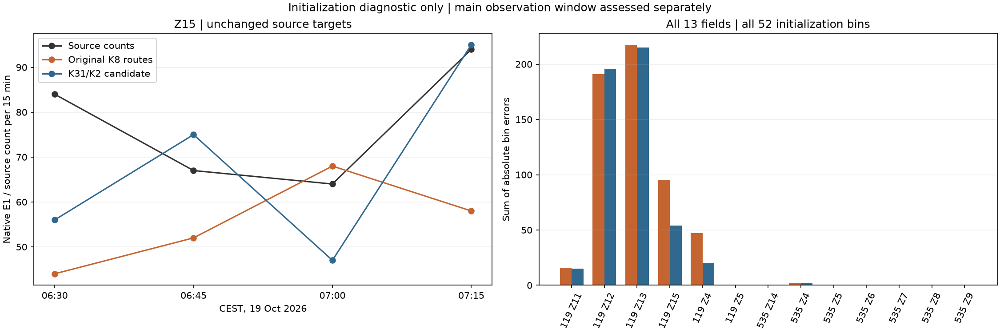

# 汉堡 Z.15 改经 K31/K2：小样本与初始化小时

本次保持信号不变，只将 Z.15 需求改分配到已有的 K31/K2 路线。
20 辆人工检验车全部完成指定字段通过并到达，无碰撞、传送或积压。
完整初始化小时的 Z.15 通过数从 222 增至 273，但其余字段合计减少 11 次。
全体仍有 364 辆未进入，不能作为有效标定接受。

## 路线先验与固定条件

此前 [K8 诊断](../hamburg_ring1_z15_K8_diagnosis_20261021_v1/README.md) 发现，两个入口方案均经过每周期只有 5 秒绿灯的 K8 左转。
本次采用现有路线配置 89、252，经 K31、K2，避开 K8。
这些路线来自原有限路线池，没有新开道路或将车辆直接放到检测器前。

| 配置 | 入口 | 机动车道 | 既有十五分钟入口先验上限 | 本次最大请求 |
|---|---|---:|---:|---:|
| 89 | `189764301`，Holzdamm | 2 | 100 | 71 |
| 252 | `61578529#1`，An der Alster | 1 | 50 | 35 |

每个目标时段按 2:1 机动车道先验分配，用最大余数法取整数，并交错安排两条路线。
该比例和入口上限均为声明，不是实测 OD 或现场通行能力。
新路线保留普通乘用车权限和官方支持的计划转向，没有重复道路、重复物理路口、掉头或客户道路。
每条路线仍只经过一个被观测道路。网络的合法转向和掉头保持原样。

全部 8640 辆模型车辆保留。
其中 Z.15 的 309 辆初始化车辆和 896 辆主窗车辆改变路线，其余车辆路线不变。
全部身份、请求时间、类型、移动途经点、人口类别、目标字段和目标时段均不变。
没有按新自由流时延调整请求时间。
初始化两入口各承担 207、102 辆请求，主窗各承担 599、297 辆请求。

原主窗 130 行目标、40 个派生站点目标及初始化 52 行目标均保持原样。
网络、控制输入和传感器文件逐字节不变。
104/118 固定 SP5 近似、Z.15/K9 备选、其他 OSM 感应控制及 200 施工阶段不一致继续保留。

## 人工小样本

两条路线各 10 辆，交替每 3 秒出发，从仿真 100 秒开始。
仿真 0 为当地 06:30，结束 900 秒。使用 SUMO、TraCI 1.27.1，步长 0.1 秒，seed 104。
控制、车辆类型和局部断面车道保持方式与正式候选相同。

20 辆均通过指定 Z.15 字段一次，没有通过其他字段或重复通过。
20 辆均到达，结束时无在途、未进入、碰撞、传送或丢弃车辆。
原生 E1 周期计数与瞬时完整通过身份一致。
人工目标为 Z.15 的 20 次通过，其余 12 个字段为 0。这些人工目标不替代真实观测。
详见 [小样本结论](small-probe/probe-check.json) 和 [原生记录](small-probe/native/)。

## 完整初始化小时

保留全部未来主窗车辆，仅运行当地 2026-10-19 06:30–07:30，即 04:30–05:30 UTC。
SUMO、TraCI 1.27.1，步长 0.1 秒，seed 104。
每步执行局部车道保持和静止检查，全部在途车辆静止 300 秒时终止。
本次正常到达 3600 秒。

| 检查项 | 原 K8 路线 | K31/K2 候选 |
|---|---:|---:|
| 本小时请求车辆 | 1953 | 1953 |
| 实际进入 | 1533 | 1589 |
| 到达 | 1308 | 1347 |
| 结束时仍在路网 | 225 | 242 |
| 已请求但未进入 | 420 | 364 |
| 碰撞 / 传送 / 丢弃 | 0 / 0 / 0 | 0 / 0 / 0 |
| 原生 E1 完整通过 | 1431 | 1471 |
| 完全一致的初始化字段时段 | 32 / 52 | 32 / 52 |
| 诊断 MAE | 10.923076923076923 | 9.653846153846153 |
| 诊断最大绝对残差 | 82 | 81 |



全部 52 行均保留，11 行绝对误差改善，5 行变差，36 行不变。
没有用总量增加替代逐时段拟合，也没有隐藏其他字段的退步。
全部 1471 次完整通过均对应指定字段一次，没有其他字段通过或重复通过。
计数只读原生 E1 `nVehContrib`，道路前端离开数不参与计数验收。
本次有两次紧急制动警告，原始日志保留。

Z.15 四个目标为 84、67、64、94。
原 K8 路线测得 44、52、68、58，新候选测得 56、75、47、95。
新残差为 −28、+8、−17、+1，四行均未精确一致。
两个新入口的 309 辆初始化车全部进入，273 辆完成字段通过，36 辆尚未完成字段通过。

主要剩余未进入车辆位于 `44532531` 的 266 辆和 `25866659#1` 的 98 辆。
后者比原方案多 9 辆，不能只报告前者的改善。
全部差值见 [52 行比较](analysis/field-change.csv)，全部入口见 [逐入口表](analysis/entry-delays.csv)。

## 判断与边界

**已验证**：两条路线通过人工小样本检验，较大初始化车流中的 Z.15 通过数和整体绝对误差有所改善。
**候选**：2:1 路线先验及其初始出发时间，仍不识别真实 OD 或自然驾驶行为。
**未完成**：全部主观测窗计数的有效零误差，以及进入积压和跨时段误差的解决。

本包只报告人工检验和初始化小时。主观测窗须单独完整评估。
随后完成的 [主窗试验记录](../hamburg_ring1_z15_k2_full_20261021_v1/README.md) 保留全部 130/40 行比较。
该试验在尾段超时，主窗诊断字段 MAE 为 19.885，没有通过标定。
没有把初始化也必须零误差设为新验收门槛，但当前大规模未进入车辆仍须保留。
保存的原生状态仅作证据，局部车道保持过程的恢复仍未验证，不能据此宣称可重启标定。

## 复现与证据

在仓库根目录使用新输出目录执行：

```powershell
$env:PYTHONPATH = "$PWD/plugins/astra-sumo/src"
$env:SUMO_HOME = "$PWD/.venv/Lib/site-packages/sumo"
$env:PATH = "$env:SUMO_HOME/bin;$PWD/.venv/Scripts;$env:PATH"
$env:PYTHONUTF8 = '1'
.venv/Scripts/python.exe plugins/astra-sumo/scripts/prepare_hamburg_readme_initialization.py z15-k2 benchmarks/hamburg_ring1_initialization_population_20261021_v1 outputs/new-k2-inputs --profiles-file benchmarks/hamburg_ring1_m1_2_demand_pool_20261021_v1/base/ideal-lane-profiles.json.gz
.venv/Scripts/python.exe plugins/astra-sumo/scripts/prepare_hamburg_readme_initialization.py probe-z15-k2 outputs/new-k2-inputs outputs/new-k2-probe
.venv/Scripts/python.exe plugins/astra-sumo/scripts/prepare_hamburg_readme_initialization.py run outputs/new-k2-inputs outputs/new-k2-initialization
```

- 执行：[入口](../../plugins/astra-sumo/scripts/prepare_hamburg_readme_initialization.py)、[路线构造和小样本](../../plugins/astra-sumo/src/astra_sumo/core/hamburg_z15_routes.py)、[初始化执行](../../plugins/astra-sumo/src/astra_sumo/core/hamburg_initialization.py)。
- 分析：[核对记录](analysis-at-verification.py)、[绘图记录](plot-at-verification.py)、[逐项核对](analysis/independent-checks.json)、[原方案与候选](analysis/comparison.json)。
- 参数及输入：[完整输入](inputs/)、[场景](inputs/scenario.json)、[路线先验](inputs/z15-k2-proposal.json)。
- 原始结果：[小样本](small-probe/)、[初始化](native/)、[本小时结论](native/initialization-check.json)。
- 检查：[测试](tests.xml)、[实现校验值](implementation-sha256.json)、[文件清单](manifest.json)。

大文件使用无损 gzip。来源署名和许可沿用 [官方源包](../hamburg_ring1_official_sources_20261020_v1/README.md) 与 OSM。
网络未变，沿用原固定航拍和 NetEdit 图。
