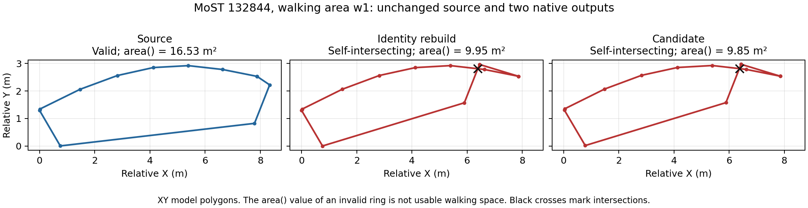

# Source-relative walking-area validity, 2026-10-19

This dated follow-up supersedes the 132844 outcome in the
[first pedestrian record](pedestrian-paths-20261019-v1.md) and earlier
[three-case table](topology-source-20261019-v2.md). The earlier records remain
unchanged. The [new record](pedestrian-paths-20261019-v2.json) binds the results
to code, inputs, native outputs, and verified CI.

## Corrected classification

Commit `8a2d756` compares facility structure with the immutable source in every
case. Commit `e1236f1` also compares walking-area validity with that source.
Neither check depends on whether native reconstruction preserves the original
geometry. The native identity control still supplies the geometry comparison
and retains its own failure reason.

The final read-only assessment reuses every original native artifact. It does
not replace a failed case or run a new full release for all three candidates.

| Junction | Previous outcome | Current applicability | Reason |
|---|---|---|---|
| `132844` | `review_required` | `blocked` | A valid source walking area becomes self-intersecting. |
| `132981` | `pass` | `pass` | The technical profile still passes. |
| `133544` | `review_required` | `review_required` | Changed pedestrian layouts remain unsupported for automatic acceptance. |

All ledger, network, control, source, and reference hashes stayed unchanged.
The implementation also stayed unchanged during assessment. An applicability
pass alone does not replace the remaining release checks.

## What failed at 132844

Walking area `:132844_w1_0` is valid in the source. Its XY polygon area is
16.5332 m². It is already self-intersecting in the reconstruction control and
remains self-intersecting in the candidate. The reported `area()` values are
9.950737 and 9.854055 m². Values from invalid rings do not measure usable space.



The frozen summary records `present_in_identity_control: true`. The defect is
already present when the original contour is rebuilt. These observations do
not attribute it solely to the requested shape change. The neutral reason is
`candidate_newly_invalid_walking_areas`.

This corrects an overly broad interpretation of unqualified controls. Their
geometry differences require review. A known new invalid candidate polygon
still blocks automatic qualification. Existing invalid source areas do not
count as new defects.

## Independent native replay

The selected 140489 regression also reproduces directly from the checked-in
[source fixture](../../tests/fixtures/most-contour-controls/140489.net.xml) and
[node patch](../../tests/fixtures/most-contour-controls/140489-tighten.nodes.xml).
No ASTRA input preparation or exterior restoration runs in this replay.
Locked `netconvert` 1.27.1 exits successfully but writes a self-intersecting
`:140489_w0` polygon with reported XY `area()` 1.606688 m².

Run from the repository root in PowerShell. Use a new output directory.

```powershell
$foldOut = Join-Path $PWD 'outputs/native-fold-140489-v1'
if (Test-Path -LiteralPath $foldOut) { throw 'Use a new output directory.' }
New-Item -ItemType Directory -Path $foldOut | Out-Null
$foldArgs = @(
    '--sumo-net-file', 'tests/fixtures/most-contour-controls/140489.net.xml',
    '--node-files', 'tests/fixtures/most-contour-controls/140489-tighten.nodes.xml',
    '--offset.disable-normalization', 'true', '--junctions.internal-link-detail', '5',
    '--precision', '6', '--output-file', (Join-Path $foldOut 'candidate.net.xml')
)
& ./.venv/Lib/site-packages/sumo/bin/netconvert.exe @foldArgs
```

This output is a diagnostic artifact. It has not passed the ASTRA candidate
checks. A separate trial with `--junctions.corner-detail 0` leaves the fold
unchanged. No native workaround or geometry repair was adopted.

## Verification

All 33 related local tests passed. Ruff and `git diff --check` passed.
Both complete Windows CI suites for `e1236f1` passed **3519 tests with 24 skips**:
[PR suite](https://github.com/Tarard/ASTRA-SUMO/actions/runs/39292004838) and
[push suite](https://github.com/Tarard/ASTRA-SUMO/actions/runs/39291995904).
Contract and export checks also passed.

Claude independently ran 33 related tests and reported no new code bugs.
Its source-validity observations agree with the corrected classification.
This follow-up addresses its request to retain an updated dated record.

## Reproduction artifacts and limits

Paths are relative to the repository. Large generated runs remain local.

- Reassessment runner: `outputs/pedestrian_paths_20261019_v1/rescore-source-validity.py`.
- Input cases: `outputs/contour_preservation_20261019_v1/most-repeat/`.
- Results: `outputs/pedestrian_paths_20261019_v1/source-validity-three-case-rescore/results.json`.
- Polygon analysis: `outputs/pedestrian_paths_20261019_v1/inspect-132844-area.py` and `132844-area-details.json`.
- Native replay: `outputs/pedestrian_paths_20261019_v1/verify-standalone-packet.py` and `native-standalone-packet/results.json`.
- Native option trial: `outputs/pedestrian_paths_20261019_v1/probe-native-corners.py` and `native-corner-probe/results.json`.

The plot uses saved XY coordinates. Only this standalone plot used the user's
standard Python 3.13 installation. Native runs and project tests used the
repository environment. No project dependency was added for plotting.

This work fixes classification and preserves failed candidates. It does not
repair every native reconstruction, establish field defects, estimate cleaning
precision, or validate mixed vehicle-pedestrian interactions. Automatic
acceptance of genuinely changed pedestrian layouts remains incomplete.
