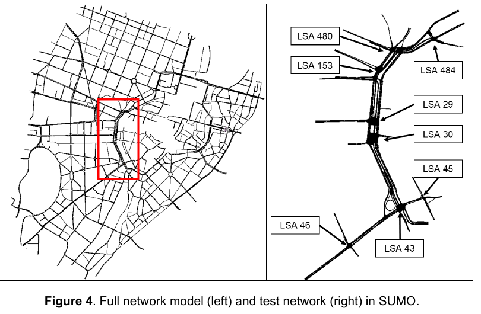

# 汉堡走廊剪枝：18项文献核查与当前道路清单

日期：2026-10-22。研究范围仍为README的Binnenalster/Ring1，包含LSA104、118、119、200、535。
本次只查文献和现有道路，没有删路、改变信号、移动检测器或启动剪枝仿真。

## 判断

文献支持把研究对象收缩到一条可解释的走廊，并把外围交通明确表示为边界流入和流出。
它们没有给出“支路越少，计数一定越准”的通则。
道路筛选、相邻路段合并、路口重建、出行范围截取和真实封路，是不同处理。
不能把这些处理的结果混在一起，归因于删掉了更多道路。

对汉堡，我建议优先整理“走廊骨干＋五个完整物理路口＋必要进出口”。
这是一项基于文献和当前数据提出的范围修订建议，尚未验证它能减少残差。
全部13个检测字段、130个字段时段及40个派生站点时段继续保留。

## 检索和阅读范围

核查18项研究来源，覆盖慕尼黑、汉诺威、杭州滨江、博洛尼亚、因戈尔施塔特、卢森堡、摩纳哥、都灵、巴塞罗那、查塔努加、北京及Alicante–Murcia走廊等地区。
10项取得机构或出版机构的PDF，并核读相关方法和实验段。
另8项通过作者、机构或出版社的网页正文、索引方法段、场景说明或元数据核对。
这些阅读程度逐项列出，不把只读到摘要的材料作为剪枝规则依据。
同一论文的会稿、预印本和刊出版本只计一次。共享同一城市底图的研究也不是独立的重复验证。

检索围绕真实地图、实际交通数据、范围裁定、低交通量支路、外部交通、路口简化和网络精度展开。
只用原论文、作者或机构仓储、出版社和官方指南支持方法判断。
检索结果的抓取日期不作为论文发表年份。Crossref的论文类型也不替代会议论文、书章和期刊论文的实际身份。

标签：T2表示方法可借鉴，E2表示实验证据有范围限制，L表示线索，X表示某一做法不适合本任务。
X不代表整篇论文没有价值。本文没有提出新的理论证明。

## 直接相关的方法

**慕尼黑走廊。** 作者截取Sonnenstraße及重要进出口，排除低交通量街道，保留8个信号路口。
但取样路线仍高估掉头和小街流量，约15分钟后严重堵塞。其检测数据还作过筛除。
可借鉴范围裁定，不能把它作为“删路即可标定成功”的证据，也不沿用其筛除观测目标的处理。[Keler等，§3–4，印刷页157、162](https://d-nb.info/1297415906/34)

图为Keler等（2023）Figure 4，印刷页157。左为原网络，右为试验走廊。
图从原PDF第5页直接渲染，仅取图和图题区域。作者授权为[CC BY 3.0 DE](https://creativecommons.org/licenses/by/3.0/de/)。
这不是汉堡候选，也不是成功标定的展示。

**博洛尼亚的小范围场景。** 原始场景省略少量小街，但保留边界道路的进入数量，以及路口实测转向比例。
它说明删掉外围道路后，相关交通必须仍有明确来源和去向。[Bieker等，§1.4，PDF第4页](https://elib.dlr.de/89354/1/SUMO2014_scenarios.pdf)

**核心细、外围粗。** 博洛尼亚的大范围模型保留详细城区，并用主要道路表示外部地区。
摩纳哥也用外围车辆交通支持核心区的进出流。这类方法精简外围细节，但保留外部需求。[Schweizer等，§2.1](https://www.mdpi.com/2220-9964/10/3/165)、[Codecá和Härri，§III](https://www.eurecom.fr/publication/5350/download/comsys-publi-5350.pdf)

**道路简化不等于支路删除。** TSMM合并平行道路和辅路，并用路口模板降低转换复杂度。
其压力试验使用合成交通，且方法会丢失转向限制。本文只借鉴识别错误路口表示的思路，不移植其加车道、全转向或模板几何。[Meng等，§4–6](https://www.cms-labs.org/bib/meng2022topologypreserving/meng2022topologypreserving.pdf)

**小支路也可能必须保留。** RealTwin的短走廊保留4个无信号路口，并标定缺少数据的支路流入与转向。
它提供了另一种选择：保留实际有供流作用的支路，估计其交通，而不是统一删除。[Xu等，校准模块与案例，作者稿第8、11页](https://www.osti.gov/pages/servlets/purl/2584498)

**边界应容纳影响走廊的排队。** 官方微观仿真指南要求把影响区包含在范围内，边界出现排队时需重新检查范围。
因此不能在检测器后立即结束车辆，以消除真实的下游阻塞。[TxDOT，§13.2](https://www.txdot.gov/manuals/des/tsp/chapter-13-microsimulation-analysis/13-2-project-scope.html)
该指南中的具体空间扩展建议不直接作为汉堡固定bbox的修改指令。

## 18项来源逐项核查

下表的“做法”只描述已读到的材料。“未报告”不等于作者没有做过该处理。

| 编号 | 文献、身份与阅读程度 | 地图和数据 | 已核对的范围处理 | 标签与本任务的边界 |
|---|---|---|---|---|
| P01 | Keler、Kunz、Amini、Bogenberger，2023，[慕尼黑数字孪生](https://doi.org/10.52825/scp.v4i.223)。会议论文。PDF方法与结果 | OSM、官方检测与信号资料 | 主走廊及重要进出口，删除低流量小街 | T2/E2。剪枝后仍堵塞失败。没有可直接移用的流量删除阈值 |
| P02 | Ostendorf、Garlichs、Wolf，2025，[HaTS](https://doi.org/10.52825/scp.v6i.2605)。会议论文。PDF§3.1及评价 | OSM、7个路口的机动车和自行车计数 | 排除步行、私人道路、停车、铁路和公交车道，保留住宅街区 | T2/E2。按交通方式和任务筛选，不是清空所有支路。本文保留自行车权限 |
| P03 | Meng等，2022，[TSMM](https://doi.org/10.52825/scp.v3i.111)。会议论文。PDF§4–6 | 滨江OSM；合成出行压力试验 | 道路类别筛选、平行道路和辅路合并、路口模板 | T2/E2。没有真实计数标定试验。丢失转向限制的部分为X |
| P04 | Xu、Saroj、Wang、Shao，2025，[RealTwin](https://doi.org/10.1177/03611981251349433)。TRR期刊论文。机构作者稿方法与案例 | 查塔努加真实走廊、摄像计数和控制资料 | 约0.58英里、10个路口，保留并估计未知支路交通 | T2/E2。主要路口有输入资料，单走廊结果不证明汉堡可达零误差 |
| P05 | Bieker等，2015，[Traffic Simulation for All](https://doi.org/10.1007/978-3-319-15024-6_4)。书章；已读2014机构会稿 | 博洛尼亚实测边界交通和转向数据 | 略去少量小街，明确边界进入量 | T2/E2。依赖已有场景资料，不是从稀疏字段自行恢复完整OD |
| P06 | Lobo等，[InTAS](https://doi.org/10.52825/scp.v1i.102)。2020会议、DOI记录2022刊出。已读场景PDF | OSM、人口资料、24处交通计数、部分真实信号方案 | 排除私人街道及部分交通方式；外围村镇内部不建模，但保留与城区的交通 | T2/E2。外部需求不能随道路一起消失。正文和表中道路长度有小差异，不用其数值设阈值 |
| P07 | Harth、Langer、Bogenberger，2022，[需求与信号自动标定](https://doi.org/10.52825/scp.v2i.120)。2021会议论文。PDF方法与评价 | 因戈尔施塔特真实信号和检测资料 | 使用大范围网络，重点做观测对应与信号重建 | T2/E2。未读到通用的支路删除规则，不把成功归因于少支路 |
| P08 | Khaleghian等，2023，[车辆速度标定](https://doi.org/10.1109/SMARTCOMP58114.2023.00076)。SMARTCOMP会议论文。机构PDF方法与实验 | 查塔努加OSM、OD及2160处速度资料 | 人工检查主要路口；未报告可移用的支路剪除准则 | E2/L。速度标定不等于字段计数标定 |
| P09 | Zhuge、Shao、Yang，2019，[MATSim-Beijing](https://doi.org/10.1016/j.jocs.2019.101046)。期刊论文。作者稿§3网络试验 | 北京真实地图、调查和流量资料 | 合并相邻路段，比较不同合并长度 | T2/E2。使用某种简化网络标定后，改精度会改变拟合。长路段合并不移植到本任务的车道与路口模型 |
| P10 | Gonzalez-Delicado等，2021，[Alicante–Murcia](https://doi.org/10.1109/ACCESS.2021.3126269)。IEEE Access期刊论文。机构PDF方法与评价 | 97 km高速公路、99个线圈、36个入口和34个出口 | 只建研究走廊，但保留匝道及边界交通 | T2/E2。高速公路的需求方法不能直接替代城市信号路口处理 |
| P11 | Codecá、Härri，2017，[MoST初步方案](https://doi.org/10.1109/VNC.2017.8275627)。VNC会议论文。作者网站正文 | 摩纳哥OSM、人口和公共交通等公开资料 | 核心区详细，外围以机动车和公交支持进出流 | T2/E2。2017文献是初步构建，未验证全部真实计数 |
| P12 | Codecá、Frank、Engel，2015，[LuST构建](https://orbilu.uni.lu/bitstream/10993/23011/1/LC_LuSTScenario.pdf)。VNC会议论文。机构索引中的构建方法段，PDF访问失败 | OSM、人口与活动资料，交通为合成出行 | 保留主要和住宅道路，人工修正路口；同时有权限与车道简化 | T2/E2。取消车种限制的处理不采用。2017扩展评价只核对到记录，不另计全文阅读 |
| P13 | Bedogni等，2015，[Bologna Ringway](https://doi.org/10.1109/TVT.2015.2475608)。IEEE TVT期刊论文。作者网站正文§III–V | OSM、实际出行资料、导航服务验证 | 重点修正道路转换、车道连接与信号；不是简单删去小街 | T2/E2。针对旧版SUMO的修正规则不能直接当作1.27.1的缺陷或修复 |
| P14 | Schweizer等，2021，[大范围博洛尼亚](https://doi.org/10.3390/ijgi10030165)。期刊论文。已核对出版社§2.1方法段，未取得本地PDF | OSM、OD、GPS、公交与流量数据 | 详细核心区，外围主要道路连接城镇，表达外部需求 | T2/E2。不能把外围主要道路全部剪掉 |
| P15 | Nguyen等，2024，[Superblock设计](https://doi.org/10.3390/ijgi13030077)。期刊论文。出版社方法与图说明，未取得本地PDF | 博洛尼亚真实底图及流量资料 | 更新并扩展基础模型，随后研究真实交通干预 | L。政策封路不等于复现时的道路剪枝，不据图中骨干线推断其他街道已从基准模型删除 |
| P16 | Argota Sánchez-Vaquerizo，2022，[Barcelona Getting Real](https://doi.org/10.3390/ijgi11010024)。期刊论文。出版社§2.1方法段，机构元数据，未取得本地PDF | OSM、手机OD、调查和实际交通计数 | 先表示较大区域需求，再提取核心范围及相关出行 | T2/E2。强调过境交通完整性，不支持一律缩小范围 |
| P17 | Jeon、Shin、Park，2025，[ODCalibrator](https://doi.org/10.3390/app151810246)。期刊论文。出版社案例和局限段，未取得本地PDF | 微观仿真标定的可视分析案例 | 改变关注道路和误差统计集合，不等于物理删路 | L/X。其排除低流量关注道路的做法不能用于宣布本任务130行全部拟合 |
| P18 | Rapelli、Casetti、Gagliardi，2022，[TuST](https://doi.org/10.1109/TMC.2021.3075985)。IEEE TMC期刊论文。已核对机构记录和作者场景说明，PDF访问失败 | 都灵OSM、5T真实OD、检测与信号资料 | 资料确认人工网络修正，但本次未读到可核实的具体剪枝阈值 | L。不据摘要或引用它的其他论文推定其删路方法。2019会稿不重复计数 |

## 汉堡现状：道路数量与交通作用分开看

本次读取的是当前完整参考的实际运行网络，SHA-256为`cc04537494708721e1ad87409ab47cef249c3774dbaf9ed3ec7a7b01710672a4`。
该网络有360条普通路段，其中343条允许乘用车通行。8640辆模型车的明确路线共使用116条路段。
因此，有227条允许乘用车通行的路段不在当前生成路线中。
这些是模型路线使用情况，不是现场交通量，也不构成删除许可。

不能把91条过街连接、147个步行区域或632条内部通路计作普通支路。
剪枝阶段记录的467条源路段和重建后的360条普通路段也不是同一划分口径。
逐路段数据见[道路清单](../../benchmarks/hamburg_ring1_pruning_literature_20261022_v1/road-inventory.csv)，生成方法和输入哈希见[证据目录](../../benchmarks/hamburg_ring1_pruning_literature_20261022_v1/README.md)。

这项发现支持整理范围，但没有证明227条都可删除。
其中还包括未被当前需求使用的主干道、官方路口进出口和其他可能的合法去向。
删掉完全不承载模型车的外围道路，若不改变交通连接、信号和边界需求，本身也不会直接补足检测器计数。
它的作用可能是减少无依据的路线选择、控制假设和转换错误，需要具体识别。

对“支路太多”的判断，我目前区分三种待核对的机制：

1. 供流分配：少量短支路被安排过多进入需求。已有失败运行直接支持检查这一项。
2. 控制与几何：细碎道路可能使同一通路被额外信号阻断，但现场控制归属必须有依据。
3. 无关范围：保留了研究任务不需要的外围道路，增加人工修正负担，但未必直接造成当前残差。

这三项是对汉堡的推断，不是论文已经替本案例证明的原因。

## 只推进一个范围方案

建议采用慕尼黑和博洛尼亚小范围场景的基本做法，并保留外围供流与下游约束。
先形成一张道路保留/边界化/候选排除清单，再生成同范围航拍对照。不立即再做一组需求参数变体。

| 决策 | 文献依据 | 汉堡的处理建议 | 尚缺的证据 |
|---|---|---|---|
| adapt：按研究问题确定走廊 | P01、P05 | 保留五个官方物理路口、连接骨干和13个检测断面 | 每条候选支路是否参与必要供流、转向或排队传播 |
| adopt：删外围细节时保留外部交通 | P05、P06、P11、P14、P16 | 将非研究区交通表示为真实道路边界的流入/流出，避开路口内部断口 | 边界流量、转向和足够的真实道路储车空间 |
| reject：统一按OSM等级删除 | P02、P03、P04 | 道路等级作初筛。实际有供流作用的支路和合法转向仍需保留 | 不把OSM类别当作实测交通量 |
| reject：在字段后立即清空车辆 | P10和官方范围指南 | 保留会影响检测断面的下游通路与信号 | 119向209方向的真实控制及回堵范围 |
| adapt：改变道路表示后重新标定 | P09 | 原需求只作参照，不能把旧路线和计数响应直接用于新范围 | 新范围下的原生运行和同一组130/40行残差 |
| reject：更换误差统计集合 | P17与本任务约束 | 始终保留全部130字段行；站点只是字段和 | 没有缺失补零，也不删难匹配字段 |

以上是待检验的范围建议，尚未实施剪枝。
固定bbox、五个官方路口、全部观测、道路通行权限和合法转向仍是本案例的约束。
不把提升通行能力或减少模型路数，单独视为更接近现场或标定完成。

## 资料与复核位置

- 文献获取记录和元数据：[证据目录](../../benchmarks/hamburg_ring1_pruning_literature_20261022_v1/README.md)。访问失败也保留，没有绕过受限访问。
- 本地完整资料：`outputs/hamburg-pruning-literature-20261022-v1/`。受版权保护的全文不提交到仓库。
- 本次范围清单只读原完整参考，没有新的剪枝仿真。原始失败运行继续保留。
- 正在运行的有限次请求时刻校正是此前已启动的独立记录，不构成本文剪枝方案的试验。
